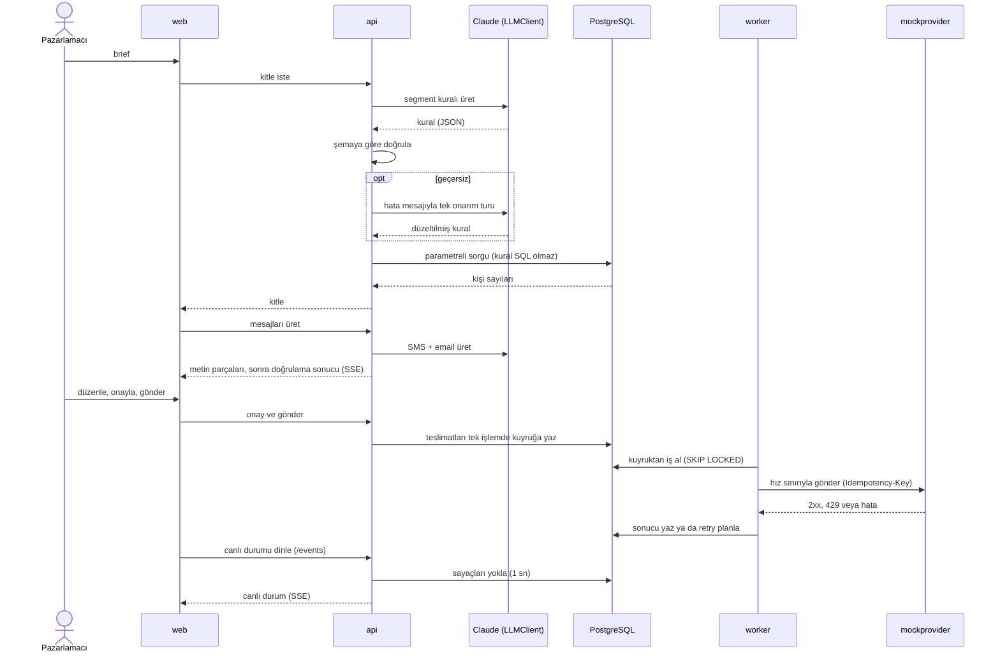
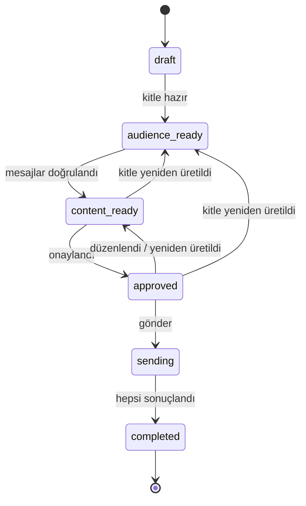
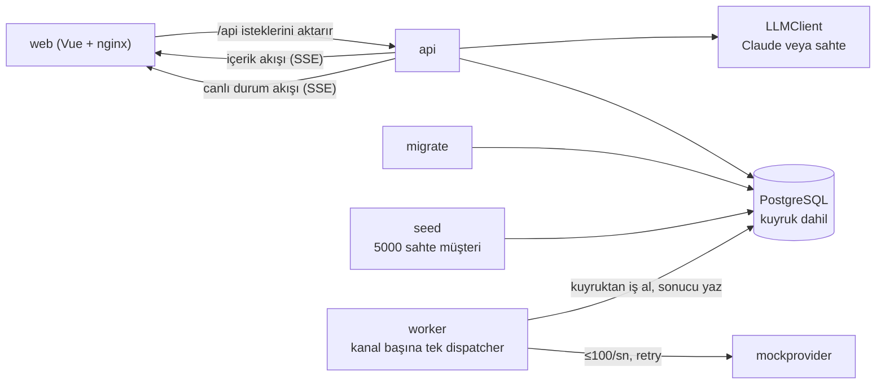

# Smart Campaign Composer

Pazarlamacı ne istediğini doğal dille yazar. Claude hedef kitleyi ve SMS ile email metinlerini önerir, son kararı insan verir. Onaylanan mesajlar bir kuyruktan geçerek gönderilir ve gönderim canlı izlenir.

| | |
|---|---|
| Frontend | Vue 3 (Vite, TypeScript, Pinia, shadcn-vue + Tailwind CSS v4) |
| Backend | Go |
| LLM | Claude API (Anthropic Go SDK), anahtar yoksa sahte LLM |
| Veritabanı ve kuyruk | PostgreSQL |

Bu README, case dokümanının başlıklarını izler: her başlıkta istenenin nasıl karşılandığı ve ayrıntının nerede olduğu yazar. Kararların gerekçesi ve alternatifleri [`DECISIONS.md`](DECISIONS.md)'dedir.

## İçindekiler

- [Kurulum](#kurulum)
- [İş bağlamı](#iş-bağlamı)
- [Kullanıcı akışı](#kullanıcı-akışı)
- [Fonksiyonel gereksinimler](#fonksiyonel-gereksinimler)
- [AI gereksinimleri](#ai-gereksinimleri)
- [Kaynaklar](#kaynaklar)
- [Teknoloji ve mimari](#teknoloji-ve-mimari)
- [Teslim edilecekler](#teslim-edilecekler)
- [Bonus](#bonus)
- [AI araçları kullanımı](#ai-araçları-kullanımı)
- [Değerlendirme başlıklarına göre nereye bakılır](#değerlendirme-başlıklarına-göre-nereye-bakılır)
- [Yetiştirilemeyenler ve bilinen sınırlar](#yetiştirilemeyenler-ve-bilinen-sınırlar)

## Kurulum

Gereken yalnızca Docker (Compose v2.24 veya üstü; isteğe bağlı `.env` için) ve make.

```sh
cp .env.example .env   # isteğe bağlı; dosya yoksa da çalışır
docker compose up      # veritabanı, migration, seed, api, worker, mock provider, web arayüzü
make test              # tüm testler (Go + Vitest) konteynerde, API key'siz
make help              # diğer komutlar
```

`docker compose up` bitince tarayıcıda <http://127.0.0.1:8081> adresini açın. Bu port başka bir programda doluysa `.env` dosyasına `WEB_PORT=8082` gibi boş bir port yazın; API için `API_PORT` aynı şekilde çalışır. Hangi portun açıldığını `docker compose ps` gösterir.

`.env` dosyasına `ANTHROPIC_API_KEY` yazarsanız sistem gerçek Claude'u kullanır (varsayılan model `claude-opus-5-5`, `ANTHROPIC_MODEL` ile değişir); boş bırakırsanız sahte LLM çalışır. `LLM_PROVIDER=mock` anahtar olsa da sahte LLM'i seçer, `real` ise anahtar yoksa açılışta hata verir. Örnek: [`.env.example`](.env.example).

Koda katkı verecekseniz klonladıktan sonra ilk iş `make hooks` (lefthook ve gitleaks gerekir; araç listesi [`CLAUDE.md`](CLAUDE.md) "Komutlar").

## İş bağlamı

Bir kampanya hazırlamak için kitleyi tanımlamak, her kanal için metin yazmak ve karakter limitlerine uymak gerekir. Bu araçta pazarlamacı yalnızca ne istediğini yazar; kitleyi ve metinleri Claude önerir, her adımda son kararı insan verir.

Bilerek yapılmayanlar: gerçek kimseye mesaj gitmez (alıcılar seed edilmiş sahte kullanıcılardır, gönderim kendi yazdığımız mock provider'adır) ve kimlik doğrulaması yoktur (yerel demo, yalnız `127.0.0.1`'e açılır).

## Kullanıcı akışı

Örnek brief:

> "Son 30 günde sepetine ürün ekleyip alışveriş yapmayan İstanbul'daki kullanıcılara %30 indirim hatırlatması gönder. Samimi ama kısa olsun."

1. **Kitle çıkarılır.** Claude brief'i bir segment kuralına çevirir (şehir, son 30 gün, sepet gibi alanlar). Arayüz kaç kişinin eşleştiğini, kaçına SMS ve email ile ulaşılabildiğini gösterir. İnsan kitleyi kontrol eder, gerekirse yeniden üretir.
2. **Mesajlar üretilir.** Claude SMS ve email metnini yazar; metin ekrana akarak gelir. Claude düşünürken ekranda bekleme göstergesi görünür.
3. **İnsan onaylar.** Pazarlamacı metni önizler, düzenler ve onaylar. Onaydan sonra metin değişirse onay düşer, yeniden onaylanır.
4. **Gönderilir.** "Gönder" ile teslimatlar kuyruğa yazılır; worker bunları kanal başına hız sınırıyla mock provider'a gönderir.
5. **Canlı izlenir.** Takip ekranı gönderilen, bekleyen ve başarısız sayılarını sayfa yenilenmeden gösterir. Kampanya tamamlanınca başarısız teslimat varsa "Başarısızları gör" listeyi açar.

Ekranlar telefon (375 px), tablet (768 px) ve masaüstü (1280 px) genişliklerinde kullanılabilir. Sahte LLM brief'i okumaz: hangi brief yazılırsa yazılsın aynı örnek kuralı ve metni döndürür; gerçek davranış için API key gerekir.



Kampanya şu durumlardan geçer. Kampanya düzeyinde hata durumu yoktur; tek tek mesaj hataları sayılarda görünür (D4):



## Fonksiyonel gereksinimler

### Kitle

- **LLM çıktısı asla SQL olmaz (D8).** Segment kuralı kapalı bir dildir: izinli alanlar, operatörler ve değer tipleri. Backend kuralı şemaya göre doğrular ve kendi koduyla parametreli sorguya çevirir; model ne yazarsa yazsın veritabanına yetkisiz sorgu gitmez.
- **İzni sistem uygular, model değil (D9).** SMS ve email izinleri ayrıdır. İzni olmayan kişi o kanalın kitlesinden sorguda elenir; bunu modelin akıl yürütmesine bırakmak güvence vermez.
- "Alışveriş yapmayan" son 30 günde satın alma yok demektir (D20).

### İçerik

- **Kanal limitleri:** SMS en çok 160, email konusu en çok 80 karakter; ayrıca email gövdesi en çok 5000, brief en çok 2000 karakter. Limitler, değişkenler kitledeki en uzun değerle doldurulmuş hâline göre denetlenir (D10, D37).
- **Kişiselleştirme:** `{{first_name}}`, `{{last_name}}` ve `{{city}}` desteklenir; bilinmeyen değişken reddedilir. Boş ad yerine "Değerli müşterimiz" yazılır.
- Her düzenleme yeni bir sürümdür; eşzamanlı düzenlemeler `X-Expected-Version` ile çakışma olarak yakalanır (D38, D40).

### Gönderim

- **Asenkron kuyruk PostgreSQL'dedir (D1, D2).** Gönderilecek her mesaj `deliveries` tablosunda bir satırdır; worker işleri `FOR UPDATE SKIP LOCKED` ile alır. Bu ölçekte ayrı bir kuyruk servisi gereksiz karmaşıklık olurdu.
- **Kanal başına saniyede en çok 100 mesaj (D5).** Her kanalın tek göndericisi vardır (PostgreSQL advisory lock); hız token bucket ile sınırlanır.
- **Aynı kişiye aynı mesaj iki kez gitmez (D3).** Veritabanında `UNIQUE(campaign_id, channel, customer_id)`, sağlayıcıya her denemede aynı `Idempotency-Key`.
- **Retry stratejisi (D6):** en çok 5 deneme (ilk dahil); 5xx, 408 ve zaman aşımında jitter'lı üstel bekleme (1 sn'den 60 sn'ye); diğer 4xx tekrar denenmez. 429 `Retry-After`'e uyar ve ayrı bir bütçeden sayılır (en çok 20 kez veya 10 dk). Denemesi biten teslimat `failed` olur ve takip ekranında görünür.

### Takip

- **Canlı gönderim durumu:** `/api/campaigns/{id}/events` SSE akışı; ekran sayaçları sayfa yenilenmeden günceller (D54).
- **Health ve metrics:** API portunda (varsayılan <http://127.0.0.1:8080>), web portunda değil: `/healthz` (süreç ayakta), `/readyz` (veritabanı erişilebilir), `/metrics` (Prometheus; teslimat sayaçları veritabanından, D22). Worker aynı üçünü iç ağda sunar, host'a açılmaz; mock provider yalnız `/healthz` sunar ([`docs/contracts/metrics.md`](docs/contracts/metrics.md)).
- API başvurusu: [`docs/contracts/openapi.yaml`](docs/contracts/openapi.yaml). CI, API'nin bu sözleşmeden sapmasını engeller: E2E testlerinin her isteği ve cevabı ona göre doğrulanır, router rotaları spec yollarıyla birebir eşleşir (D30).

## AI gereksinimleri

- **Doğrulama (D7, D23).** Claude serbest metin değil, araç kullanımıyla (tool use, `strict: true`) yapılandırılmış JSON döndürür. Çıktı her zaman backend'de tam şemaya göre yeniden doğrulanır. Geçersizse hatalar modele geri verilip bir kez daha üretilir; yine geçersizse kullanıcıya anlaşılır bir hata gösterilir ve kampanya durumu değişmez. Onarım turu gerçek API ile doğrulandı (D32).
- **Test edilebilirlik (D11).** LLM erişimi `LLMClient` arayüzünün arkasındadır. Anahtar yoksa sahte LLM devreye girer; `make test` ve `docker compose up` key'siz çalışır. Sahte LLM'in senaryoları geçersiz çıktı ve onarım turunu da sınar.
- Modele giden şema ile backend'in doğruladığı şema ayrı dosyalardır; strict modun desteklemediği uzunluk ve adet kuralları yalnız backend'dedir ([`docs/contracts/`](docs/contracts/README.md)).

## Kaynaklar

- **Claude API key:** yalnızca yerel `.env` dosyasındaki `ANTHROPIC_API_KEY`'den okunur; repoda [`.env.example`](.env.example) vardır. `.env` git'e girmez; hook'lar ve CI sızıntıyı tarar.
- **Sahte kullanıcı verisi (D21, D24):** 5000 deterministik müşteri. Alanlar: ad, soyad, email (`example.com`/`example.test`), kurgusal telefon, şehir (%30 İstanbul), dil (`tr`/`en`), sadakat seviyesi, SMS ve email izinleri (ayrı) ve `cart_add`/`page_view`/`purchase` olayları. Ayrıntı: [`docs/contracts/seed.md`](docs/contracts/seed.md). Seed ilk açılışta "bugüne" göre üretilir ve sonraki açılışlarda dokunulmaz (`--if-empty`); günler geçtikçe "son 30 gün" sayıları azalır. Bugüne göre yeniden üretmek kampanya ve teslimatları siler: `docker compose run --rm seed seed --ref-time=now --reset --manifest=/tmp/manifest.json`.
- **Mock SMS/email provider (D25):** ayrı bir servis. Kanal başına hız sınırı uygular, tohumlu rastgele hata (varsayılan %5), 429 (%2) ve 20–200 ms gecikme üretir; oranlar `MOCK_PROVIDER_*` ortam değişkenleriyle değişir. Testler için ayrı, yalıtılmış bir örneği vardır (`mockprovider-solo`, D55).

## Teknoloji ve mimari



- **api:** kampanya, kitle, içerik, onay ve gönderim uçları; içerik ve canlı durum için SSE (D12).
- **worker:** kuyruğu işler; her kanal için tek dispatcher, hız sınırı ve retry.
- **web:** Vue arayüzü; nginx `/api` isteklerini api'ye aktarır. Görsel sistem: [`DESIGN.md`](DESIGN.md).
- **Üretim kilidi (D41, D52):** aynı kampanyada iki üretim veya üretim sürerken gönderim olmaz; kilit kampanya satırında süreli bir kiradır.

## Teslim edilecekler

| İstenen | Durum |
|---|---|
| GitHub repository | ✅ `gulcint/smart-campaign-composer` (public; GitLab hesap doğrulaması yapılamadı, D14) |
| `docker compose up` ile tek komutla kurulum (seed ve mock provider dahil) | ✅ |
| `make test` ile çalışan testler | ✅ Go (unit, entegrasyon, API düzeyinde E2E) ve Vitest, konteynerde, key'siz |
| `README.md`: kurulum ve kısa mimari özeti | ✅ bu dosya |
| `DECISIONS.md`: önemli kararlar ve nedenleri | ✅ [`DECISIONS.md`](DECISIONS.md) |
| `ai-sessions/`: Claude session export'ları | ✅ P0–P4, temizlenmiş; P5 ve P6 eklenecek ([`ai-sessions/INDEX.md`](ai-sessions/INDEX.md)) |

Fazlar ve kapsamları ([`docs/PLAN.md`](docs/PLAN.md)):

| Faz | Durum | Kapsam |
|---|---|---|
| P0 Kurulum | ✅ bitti | Repo, hook'lar, CI, plan |
| P1 Sözleşmeler | ✅ bitti | Gereksinimler, OpenAPI, şemalar, arayüz ve Go sözleşmeleri |
| P2 Seed + altyapı | ✅ bitti | Seed, migration'lar, compose, LLM fabrikası ve sahte LLM, mock provider, `make test` |
| P3 Kitle | ✅ bitti | Segment kuralı, kişi sayıları, brief ve kitle ekranları, API sapma koruması |
| P4 İçerik + onay | ✅ bitti | SMS/email üretimi (SSE), karakter limitleri, kişiselleştirme, sürümlü düzenleme, onay, önizleme |
| P5 Gönderim + takip | ✅ bitti | Gönderim API'si, kuyruk ve worker, canlı durum akışı ve takip ekranı, veritabanında üretim kirası, responsive düzen |
| P6 Sertleştirme + teslim | ⬜ başlamadı | Tarayıcıdan uçtan uca test, güvenlik taraması, kişisel bilgi temizliği, son README ve DECISIONS |

## Bonus

| Bonus | Durum |
|---|---|
| CI pipeline | ✅ GitHub Actions; `main` için zorunlu `ci-ok`: lint, `make test`, gitleaks, govulncheck, OpenAPI sapma kontrolü (yalnız doküman değişen PR'da build/test atlanır, D51) |
| Zamanlanmış gönderim | ⬜ yapılmadı |
| A/B varyantları | ⬜ yapılmadı |
| Kullanıcının diline göre içerik | ⬜ yapılmadı (seed'de `language` alanı var) |

Öncelik, case'in istediği gibi çekirdek akışın sağlam olmasıydı.

## AI araçları kullanımı

Proje baştan sona Claude Code ile, rolleri ayrılmış ajanlarla yapıldı ([`docs/PLAN.md`](docs/PLAN.md) §3, D13):

- **Orkestratör** işi faz ve dilimlere böler, sonuçları birleştirir.
- **Test yazarı** testleri yalnızca [`docs/requirements.md`](docs/requirements.md)'den yazar, implementasyonu göremez (ayrı worktree ve hook ile zorlanır, D50).
- **Kodu yazan**, **reviewer** ve **doğrulayıcı** ayrı ajanlardır; kimse kendi işini onaylamaz.
- AI çıktısı hook'lar (commit biçimi, sır taraması, rol yolları) ve CI ile denetlenir; `main`'e yalnız `ci-ok` yeşil PR girer (D15, D33).

Session export'ları API key ve kişisel bilgilerden temizlenerek [`ai-sessions/`](ai-sessions/INDEX.md)'e eklenir (`make sanitize-sessions`, `make check-sessions`).

## Değerlendirme başlıklarına göre nereye bakılır

| Başlık | Nereye bakılır |
|---|---|
| LLM entegrasyonu | `internal/llm/`, [`docs/contracts/schemas/llm/`](docs/contracts/schemas/llm/), DECISIONS D7–D12, D23, D32 |
| Mimari ve kararlar | [`DECISIONS.md`](DECISIONS.md), [`docs/contracts/`](docs/contracts/README.md) |
| Backend güvenilirliği | `internal/delivery/`, `internal/postgres/`, `cmd/worker/`; DECISIONS D1–D6, D52–D54 |
| Frontend | `web/src/`, [`DESIGN.md`](DESIGN.md), [`docs/contracts/ui.md`](docs/contracts/ui.md) |
| Test ve kod kalitesi | `test/`, `internal/**/*_test.go`, `web/tests/`, `.github/workflows/`, [`docs/requirements.md`](docs/requirements.md) |

## Yetiştirilemeyenler ve bilinen sınırlar

Henüz yapılmayanlar:

- Tarayıcıdan uçtan uca test yok (API düzeyinde var: `test/e2e`, key'siz tam kampanya brief → `completed`).
- CodeQL ve imaj taraması yok (D27); CI `web-image`, `compose-ports` ve `actionlint` kontrollerini çalıştırmaz (D27, D51).
- Bonuslardan yalnızca CI yapıldı.
- Swagger UI gibi etkileşimli API dokümanı yok (sahip kararıyla kaldırıldı, D36).

Bilinen sınırlar:

- Üretim kilidi kampanya satırında en çok 120 sn'lik bir kiradır; bitişi API süreçlerinin saatine dayanır, süreçler arası saat kayması bitişi o kadar kaydırır (D52).
- Kanal kilidi her partinin başında denetlenir; kilit kaybolursa eski gönderici en çok bir partiyi (varsayılan 50 istek) bitirir, o kısa sürede kanalda bir partilik fazla gönderim başlangıcı olabilir. Aynı mesaj yine iki kez gitmez (D53).
- Canlı durum akışı art arda 5 başarısız okumada (≈5 sn) kapanır; ekran `stale` olur ve yeniden bağlanır. Daha kısa kesintilerde sayaçlar birkaç saniye eski kalabilir (D54).
- Elle yapılan denemede gözlenen gönderim hızı kanal başına yaklaşık 50/sn'dir, 100 sınırının altında; otomatik bir hız ölçümü yoktur.
- Gönderim anı uzunluk denetimi (`CheckRendered`) bir alıcı için iki kanalın metnini birlikte denetler: SMS metni kişiselleştirmeyle 160'ı aşarsa o kişinin email teslimatı da `content_too_long` ile başarısız olur (veya tersi). Kanal bazlı denetim sözleşme değişikliği gerektirir.
- SMS uzunluğu karakter (Unicode rune) olarak sayılır; gerçek SMS segmenti GSM-7/UCS-2'ye göre değişir, Türkçe karakterli mesajda 70'e düşer (D10).
- Email gövdesinin 5000 sınırı onay anında yeniden denetlenmez, yalnız doğrulamada denetlenir (D46).
- Brief kampanya oluşturulduktan sonra değiştirilemez; "Brief'i düzenle" yeni kampanya başlatır.
- Tekilleştirme müşteri bazındadır: aynı telefonu veya e-postayı paylaşan iki müşteri kaydı iki teslimat alır (D3).
- Kitle sorgusu eşleşen satırları Go'ya çeker; seed ölçeğinde (5000) yeterli, milyonlarca kayıtta değil. Kuyruk da bu ölçek için seçildi; yol `Queue` arayüzü (D1).
- Otomatik testler yalnızca `docs/requirements.md`'den türetilir (D50); yalnız sözleşmede yazan birçok davranış testsizdir. Gerçek Claude istemcisinin otomatik testi yoktur; şehir yazımı ve SMS uzunluğu gibi davranışlar elle doğrulanmalıdır.
- Dokunmatik boyutlar (44 px) ekran genişliğine göre (<1024 px) uygulanır, `pointer: coarse`'a göre değil; dar pencereli masaüstü de büyük hedef görür.
- İçerik ekranının eylem şeridi mobilde yapışkan değildir (sayfanın sonunda kalır); Onay ekranının karar paneli yalnız özet kartın içinde yapışkandır.

## Nereden okunur

- [`DECISIONS.md`](DECISIONS.md): önemli kararlar, gerekçeleri, bilinen sınırlar
- [`docs/PLAN.md`](docs/PLAN.md): fazlar, git akışı, roller
- [`docs/requirements.md`](docs/requirements.md): gereksinim kataloğu
- [`docs/contracts/`](docs/contracts/README.md): API, veri ve LLM araç sözleşmeleri
- [`DESIGN.md`](DESIGN.md): görsel sistem ve ekranlar
- [`ai-sessions/INDEX.md`](ai-sessions/INDEX.md): temizlenmiş Claude session kayıtları
- [`CLAUDE.md`](CLAUDE.md): proje kuralları ve ajan talimatları
