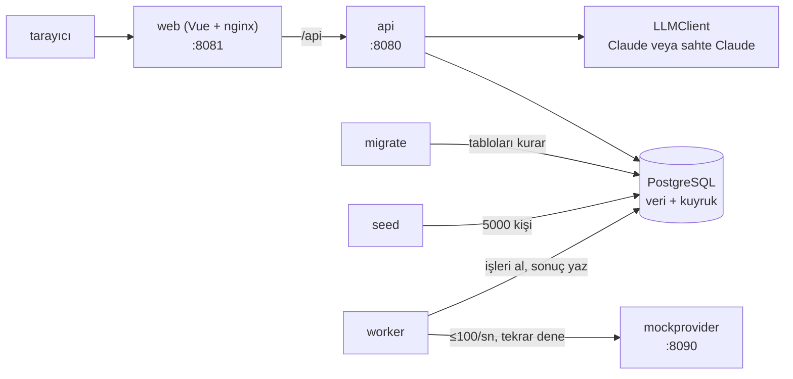

# Smart Campaign Composer

Pazarlamacı ne istediğini doğal dille yazar. Claude hedef kitleyi ve SMS ile email metnini önerir. Son kararı insan verir. Onaylanan mesajlar kuyruktan sahte (mock) bir servise gider. Gönderim ekranda canlı izlenir.

**Gerçek kimseye mesaj gitmez.** Alıcılar sahte kullanıcılardır.

Teknolojiler: Vue 3 (arayüz), Go (backend), Claude API, PostgreSQL (veri ve kuyruk).

## Durum

| | |
|---|---|
| Çekirdek akış (kitle → mesaj → onay → gönderim → izleme) | ✅ Tamam |
| API key olmadan çalışma (sahte Claude) | ✅ Tamam |
| Bonus: zamanlanmış gönderim (D62) | ✅ Tamam |
| Bonus: kullanıcının diline göre içerik (D63) | ✅ Tamam |
| Bonus: A/B varyantları (D64) | ✅ Tamam |
| Bonus: CI pipeline | ✅ Tamam |
| Ek: kampanya paneli ve takip ekranı (P10, D65) | ✅ Tamam (sahip isteği, case bonusu değil) |

## Çalıştırma

**Gerekenler:** Docker ve Docker Compose v2 (Docker açık olmalı), `make`. API key gerekmez.

**1. Klonla ve klasöre gir**

```sh
git clone https://github.com/gulcint/smart-campaign-composer.git
cd smart-campaign-composer
```

Komutları bu klasörde çalıştır. Başka klasörde `docker compose up` `no configuration file provided` hatası verir.

**2. (İsteğe bağlı) `.env` hazırla**

```sh
cp .env.example .env
```

- `ANTHROPIC_API_KEY`: boşsa sahte Claude çalışır. Sahte Claude brief'i okumaz, hep aynı örnek kitleyi ve metni döner.
- `LLM_PROVIDER`: `auto` (varsayılan) key varsa Claude'u, yoksa sahteyi seçer. `mock` her zaman sahteyi seçer. `real` key yoksa başlamaz.

`.env` git'e girmez. Değiştirince `docker compose up` komutunu yeniden çalıştır.

**3. Başlat**

```sh
docker compose up
```

İlk açılışta imajlar derlenir, biraz sürer. Servisler:

| Servis | Ne yapar |
|---|---|
| `db` | PostgreSQL 16 |
| `migrate` | Tabloları kurar, çıkar |
| `seed` | 5000 sahte kullanıcı yükler, çıkar (sonraki açılışlarda veriye dokunmaz) |
| `api`, `worker`, `mockprovider` | API (8080), gönderim işçisi ve sahte SMS/email servisi |
| `web` | Arayüz (8081); `/api` isteklerini API'ye yönlendirir |

Ctrl+C durdurur. Konteynerler kalır, aynı komutla devam eder.

**4. Hazır mı kontrol et**

- Arayüz: <http://127.0.0.1:8081>
- Sağlık: <http://127.0.0.1:8080/readyz>. `200` ve `"status":"ready"` ise hazır. `503` ise birkaç saniye bekle.
- `docker compose ps -a`: `migrate` ve `seed` `exited (0)`, diğerleri `running` olmalı.

**`port is already allocated` alırsan:** port başka programda. `API_PORT=18080 docker compose up` ile başlat; sağlık adresi <http://127.0.0.1:18080/readyz> olur. Arayüz portu da doluysa `WEB_PORT=18081` ekle. İkisi `.env` içine de yazılabilir.

**5. Testler**

```sh
make test
```

Testler kendi konteynerlerinde, ayrı geçici veritabanıyla çalışır (Compose projesi `scc-test`). Port açmaz, geliştirme verisine dokunmaz. Arayüz açıkken de çalışır.

**Durdurma**

```sh
docker compose down      # konteynerleri kaldırır, veri kalır
docker compose down -v   # veritabanını da siler; sonraki up her şeyi baştan kurar
```

Kod geliştirecekseniz önce `make hooks`. Diğer komutlar: `make help`.

### Sorun giderme

| Belirti | Neden ve çözüm |
|---|---|
| `no configuration file provided` | Klasör dışındasın. `cd smart-campaign-composer`. |
| `port is already allocated` | Port dolu. Yukarıdaki port notuna bak. |
| Docker bağlanamıyor | Docker kapalı. Docker Desktop'ı ya da servisi başlat. |
| `readyz` hep `503` | `docker compose ps -a` ve `docker compose logs migrate seed` ile hatayı bul. |
| Sahte Claude çalışıyor | `.env` yok ya da key boş. `docker compose logs api` içinde `"llm_provider":"mock"` görünür. |
| Veriyi sıfırlamak | `docker compose down -v`, sonra `docker compose up`. |

## Ne denenir

Brief ekranında **"Örnek brief'i kullan"** butonu şu metni doldurur:

> "Son 60 günde alışveriş yapmayan müşterilere %15 indirimle geri dönmeleri için mesaj gönder. Sıcak bir dil kullan."

Case dokümanındaki örnek de çalışır: "Son 30 günde sepetine ürün ekleyip alışveriş yapmayan İstanbul'daki kullanıcılara %30 indirim hatırlatması gönder. Samimi ama kısa olsun." Sahte Claude hangi brief gelirse gelsin bu İstanbul kampanyasının kitlesini ve metnini döner.

1. **Kitle:** Claude bir segment kuralı çıkarır. Kart eşleşen kişi sayısını, SMS/email alabilecek kişi sayısını ve dile göre dağılımı gösterir.
2. **Mesaj seçenekleri:** aynı kartta "A/B testi" anahtarı var. Açıksa Claude iki farklı mesaj yazar; kitle gönderimde yaklaşık yarı yarıya bölünür.
3. **Mesajlar:** SMS ve email metni ekrana akarak gelir. Kitlede İngilizce konuşan varsa TR/EN sekmeleri, A/B açıksa A/B sekmeleri çıkar.
4. **Onay:** Önizle, düzenle, onayla. Onaydan sonra düzenleme onayı düşürür.
5. **Gönderim:** Hemen gönder ya da ileri tarihe planla. Zaman seçicinin yanında "(Türkiye saati, UTC+3)" yazar. Plan değiştirilir, iptal edilir ya da hemen gönderilir.
6. **Takip:** başlıkta brief, kitle, başlama ve bitiş saati. Ana sayı tamamlanma yüzdesi ve "x / y mesaj işlendi". Sonuç (gönderildi, başarısız) ile kalan iş ayrı gösterilir. A/B'li kampanyada varyant tablosu var. Ekran "Kampanya tamamlandı" ile biter. Birkaç başarısız mesaj normaldir; mock servis bilerek hata verir.
7. **Kampanya paneli:** Brief ekranının altında özet kartları (toplam, planlanan, gönderilen kampanya; gönderilen ve başarısız mesaj) ile **Planlanan** ve **Gönderilen** listeleri. Gönderimi süren satır varken 10 sn'de bir tazelenir.


Kampanya durumları: `draft` → `audience_ready` → `content_ready` → `approved` → (`scheduled`) → `sending` → `completed`. Kitle ya da metin değişirse kampanya geri döner ve yeniden onay ister.

### Ölçülen sonuçlar

**2026-10-30, temiz klon, key yok:** sistem ~15 sn'de hazır. Case'in İstanbul brief'i API üzerinden uçtan uca çalıştı:

- 720 teslimat (351 SMS, 369 email), ~23 sn'de bitti. 0 tekrar gönderim, izinsiz kişiye 0 gönderim.
- Kanal başına en çok 46 mesaj/sn (limit 100).
- Mock servis 429 ve 5xx döndü, bunlar tekrar denendi. 11 teslimat `max_attempts_exceeded` ile başarısız oldu.

**2026-11-02, P9 doğrulayıcısı (A/B açık, canlı yığın):**

- 720 teslimat ~27 sn'de bitti. 440 kişinin %52,95'i B aldı.
- İki farklı varyant alan kişi 0. Bölme kuralının SQL ve Go hâli 440 kişide 0 fark verdi.
- Mock servise giden 1405 isteğin hepsi alıcının varyantı ve diliyle eşleşti (ağ trafiği yakalanarak).

**2026-11-02, P10 dahil son hâl, key yok:** konteynerli tam `make test` geçti: 20 Go paketinin hepsi (birim, veritabanlı entegrasyon, mock provider'la gönderim, uçtan uca API) ve 421 web testi. Arayüz derlemesi (`vue-tsc --build`) hatasız.

## Case isterleri nasıl karşılandı

Gerekçeler [`DECISIONS.md`](DECISIONS.md) içinde, D numaralarıyla.

| İster | Nasıl |
|---|---|
| LLM çıktısı SQL olmaz | Claude yalnız izinli alan, operatör ve tiplerden kural üretir. Backend doğrular, parametreli sorguyu kendisi kurar (D8). |
| Şehir yazımı | `Istanbul`, `istanbul`, `ISTANBUL` → `İstanbul`; `ankara` → `Ankara`. Kanonik liste seed'deki 10 şehirdir. Bilinmeyen şehir (ör. `Kars`) silinmez, olduğu gibi kalır ve 0 kişiyle eşleşir. Talimat, brief'teki her şehrin kurala girmesini ister (D66). |
| Kanal izni | SMS ve email izni ayrı. Kontrolü model değil sistem yapar (D9). |
| SMS ≤ 160, konu ≤ 80 | Değişkenler kitledeki en uzun değerle doldurulduktan sonra ölçülür. Her varyant × dil için ayrı (D10). |
| Kişiselleştirme | `{{first_name}}`, `{{last_name}}`, `{{city}}`. Bilinmeyen değişken reddedilir. |
| Asenkron kuyruk | PostgreSQL'deki `deliveries` tablosu kuyruğun kendisidir (D1, D2). |
| Kanal başına ≤ 100/sn | Her kanal için tek gönderici ve token bucket (D5). Sahte saatli test: `test/delivery/dispatcher_test.go`. |
| Aynı kişiye iki kez gitmez | `UNIQUE(campaign_id, channel, customer_id)`. Mock servise her denemede aynı `Idempotency-Key` gider (D3). |
| Retry | En fazla 5 deneme. 5xx ve zaman aşımında artan bekleme (1–60 sn). 429'da `Retry-After`'a uyulur, ayrı bütçeyle. Diğer 4xx denenmez. Hakkı biten `failed` olur (D6). |
| Takip | Canlı durum SSE ile akar. `/healthz`, `/readyz`, `/metrics` API portunda. |
| Yapılandırılmış JSON | Claude tool use ile JSON döner, backend tekrar doğrular. Geçersizse hatalar modele gönderilip bir kez daha denenir. Yine geçersizse kullanıcıya anlaşılır hata gösterilir (D7, D23). |
| Key'siz test | Claude erişimi `LLMClient` arayüzünün arkasında. Testler ve `docker compose up` sahte Claude ile çalışır (D11). |
| Seed | 5000 kişi: ad, email, telefon, şehir, dil, sadakat seviyesi, kanal izinleri, sepet ve satın alma geçmişi ([`docs/contracts/seed.md`](docs/contracts/seed.md)). |
| Mock provider | Ayrı servis. Rastgele hata, gecikme ve 429 döner. Demoda %40 hata ve %10 429 ayarlı (D61). |
| Bonus: zamanlanmış gönderim | Onaylı kampanya 1 dakika ile 30 gün sonrasına planlanır. Worker zamanı geleni başlatır (D62). |
| Bonus: dile göre içerik | Kitlede İngilizce konuşan varsa Claude İngilizce sürümü de yazar. Her alıcı kendi dilindeki metni alır; İngilizce yoksa Türkçe gider (D63). |
| Bonus: A/B | İstenirse (`{"ab": true}`) tek sürümde A ve B. Bölme: `sha256(kampanya ‖ müşteri)` ilk baytı `< 128` → A, değilse B. Kanala bağlı değil; kişi iki kanalda da aynı varyantı alır. Sonuç `deliveries.variant`'a yazılır (D64). |
| Bonus: CI | GitHub Actions. `main`'e girmek için `ci-ok` yeşil olmalı (lint, `make test`, gitleaks, govulncheck, API sözleşmesi). |

## Mimari



- **api:** kampanya, kitle, içerik, onay, gönderim ve özet uçları. İçerik ve canlı durum SSE ile akar.
- **worker:** kuyruğu hız sınırı ve tekrar denemeyle işler. Zamanı gelen planlı kampanyaları başlatır.
- **web:** Vue arayüzü ([`DESIGN.md`](DESIGN.md)).

### Veri modeli

| Tablo | Önemli kolonlar |
|---|---|
| `customers`, `events` | Seed verisi. Şehir, dil, kanal izinleri; `cart_add`, `purchase`, `page_view` olayları |
| `campaigns` | `brief`, `state`, `segment_rule` (JSON), `audience_matched`/`_sms`/`_email`, `audience_languages`, `scheduled_at` |
| `content_versions` | A metni (`sms_body`, `email_subject`, `email_body`), `en_*`, `b_*`, `b_en_*`, `angle_a`/`angle_b`, `status` |
| `approvals` | Kampanya başına tek etkin onay; düzenleme onayı düşürür |
| `deliveries` | Kuyruk + durum. `channel`, `status`, `attempts`, `next_attempt_at`, `failure_reason`, `variant`; `UNIQUE(campaign_id, channel, customer_id)` |

Migration'lar (`migrations/`): `0001` müşteri ve olaylar, `0002` müşteri istatistik fonksiyonu, `0003` kampanya, içerik ve onay, `0004` teslimatlar, `0005` seed kayıtları, `0006` yetki düzeltmesi, `0007` üretim kirası, `0008` planlı gönderim, `0009` İngilizce içerik, `0010` A/B varyantları.

### API uçları

Tam sözleşme: [`docs/contracts/openapi.yaml`](docs/contracts/openapi.yaml).

| Uç | Ne yapar |
|---|---|
| `GET /healthz`, `GET /readyz` | Canlılık; veritabanına ulaşılıyor mu |
| `GET /metrics` | Prometheus metrikleri |
| `GET /api/config` | Arayüzün gördüğü ayarlar (ör. sahte/gerçek Claude) |
| `POST /api/campaigns`, `GET /api/campaigns` | Brief'ten kampanya aç; kampanyaları listele |
| `GET /api/campaign-summaries` | Brief panelinin özeti; `state`, `order` süzgeci ve genel sayılar (D65) |
| `GET /api/campaigns/{id}` | Kampanya, segment, son içerik ve onay |
| `POST /api/campaigns/{id}/segment` | Claude ile segment kuralı üret |
| `POST /api/segments/count` | Verilen kuralı doğrula ve kişi say |
| `POST /api/campaigns/{id}/content` | İçeriği SSE ile üret; `{"ab": true}` B varyantını da ister |
| `GET`/`POST /api/campaigns/{id}/content-versions` | Sürümleri listele; elle düzenlemeyle yeni sürüm |
| `GET /api/campaigns/{id}/content-versions/{version_id}` | Tek sürüm |
| `GET /api/campaigns/{id}/preview` | Örnek alıcıyla önizleme; `variant=a\|b`, `language=tr\|en` |
| `POST /api/campaigns/{id}/approve` | Sürümü onayla |
| `POST /api/campaigns/{id}/send` | Hemen gönder ya da `scheduled_at` ile planla |
| `DELETE /api/campaigns/{id}/schedule` | Planı iptal et |
| `GET /api/campaigns/{id}/status` | Sayaçlar; A/B'de `by_variant` |
| `GET /api/campaigns/{id}/events` | Canlı durum (SSE) |
| `GET /api/campaigns/{id}/deliveries` | Sayfalı teslimat listesi |

## Bilinen sınırlar

- **A/B'de kazanan ölçülmez.** Mock servis açılma ve tıklama üretmez; Takip yalnız varyant başına teslimat sonucunu gösterir. Bölme oranı sabit ≈ %50/%50 (D64).
- **Gerçek modelin davranışı otomatik testte yok.** Brief'i anlama, metin kalitesi, koşul düşürme sahte Claude ile ölçülemez. `make eval` gibi bir değerlendirme yok.
- **Karşılığı olmayan koşul** (ör. "25 yaş altı") sessizce düşebilir; yaş alanı yok. Güvence, insanın Kitle kartını kontrol etmesidir. "Desteklenmeyen koşullar" tasarımı birleşmemiş bir dalda bekliyor (sahip kararı).
- **Elle gerçek API kontrolü bekliyor:** A/B + İngilizce strict şemasının gerçek API'de kabulü ve `LLM_MAX_TOKENS` (4096) sınırına sığması henüz denenmedi.
- **Şehir kanonikleştirmesi** yalnız seed'deki 10 şehri kapsar. Alt dizgi ya da yazım hatası düzeltmesi yok (D66).
- **Dil:** yalnız `tr` ve `en`. İngilizce metnin kalitesini sistem ölçmez; güvence insan onayıdır (D63).
- **Saat:** arayüz plan zamanını yalnız Türkiye saatiyle (UTC+3) alır ve gösterir (D62).
- **Ölçek:** kitle Go belleğine yüklenir. 5000 kişi için yeterli, milyonlar için değil (D1). Özet ucu indekssiz (D65).
- **Hız:** 100/sn sınırı sahte saatli testle doğrulanır. Gerçek zamanlı yük testi yok.
- **SMS uzunluğu** karakterle sayılır. Türkçe harfli gerçek bir SMS parçası 70 karakterdir (D10). Gönderim anı denetimi SMS ve konuyu birlikte değerlendirir; biri uzarsa diğeri de `content_too_long` ile düşer.
- **Brief** kampanya açıldıktan sonra değişmez. "Brief'i düzenle" yeni kampanya başlatır.
- **Aynı telefonu/emaili paylaşan iki müşteri** ayrı kişi sayılır (D3).
- **Canlı akış** kesilirse ekran `stale` gösterir ve yeniden bağlanır. Panel 10 sn'de bir yoklar; Takip ile arasında birkaç saniyelik fark olabilir (D54, D65).
- **ai-sessions:** faz orkestratör session'ları dışa aktarıldı. Bazı yan session'lar ve subagent dökümleri dışa aktarılmadı.

Tam liste: [`DECISIONS.md`](DECISIONS.md).

## Teslim edilenler

| İstenen | Durum |
|---|---|
| GitHub repo | ✅ `gulcint/smart-campaign-composer` |
| `docker compose up` (seed ve mock dahil) | ✅ |
| `make test` (key'siz) | ✅ |
| `README.md` | ✅ bu dosya |
| `DECISIONS.md` | ✅ |
| `ai-sessions/` | ✅ temizlenmiş, P0–P9 orkestratör session'ları ([`ai-sessions/INDEX.md`](ai-sessions/INDEX.md)) |

## Nasıl geliştirildi

Proje Claude Code ile, ayrı rollere sahip ajanlarla geliştirildi ([`docs/PLAN.md`](docs/PLAN.md)). Orkestratör işi böler. Test yazarı yalnız [`docs/requirements.md`](docs/requirements.md)'yi okur, kodu, sözleşmeleri ve `DECISIONS.md`'yi görmez. Kodu yazan, gözden geçiren ve doğrulayan ayrı rollerdir. `main`'e yalnız CI'ı yeşil PR girer.

## Nerede ne var

| Konu | Yer |
|---|---|
| LLM entegrasyonu | `internal/llm/`, `docs/contracts/schemas/llm/` |
| Segment kuralı ve şehir yazımı | `internal/segment/`, `internal/segment/city.go` |
| İçerik, A/B bölmesi | `internal/content/` |
| Gönderim | `internal/delivery/`, `internal/postgres/`, `cmd/worker/` |
| Arayüz | `web/src/pages/`, `web/src/components/` (ör. `CampaignPanel.vue`, `AbToggle.vue`, `VariantBreakdown.vue`), [`DESIGN.md`](DESIGN.md) |
| Arayüz metinleri | `web/src/i18n/tr.ts` |
| Veritabanı | `migrations/`, [`docs/contracts/db-schema.md`](docs/contracts/db-schema.md) |
| Kararlar ve sözleşmeler | [`DECISIONS.md`](DECISIONS.md), [`docs/contracts/`](docs/contracts/README.md) |
| Testler | `test/`, `internal/**/*_test.go`, `web/tests/`, [`docs/requirements.md`](docs/requirements.md) |
| Plan ve fazlar | [`docs/PLAN.md`](docs/PLAN.md) |
| Proje kuralları | [`CLAUDE.md`](CLAUDE.md) |
