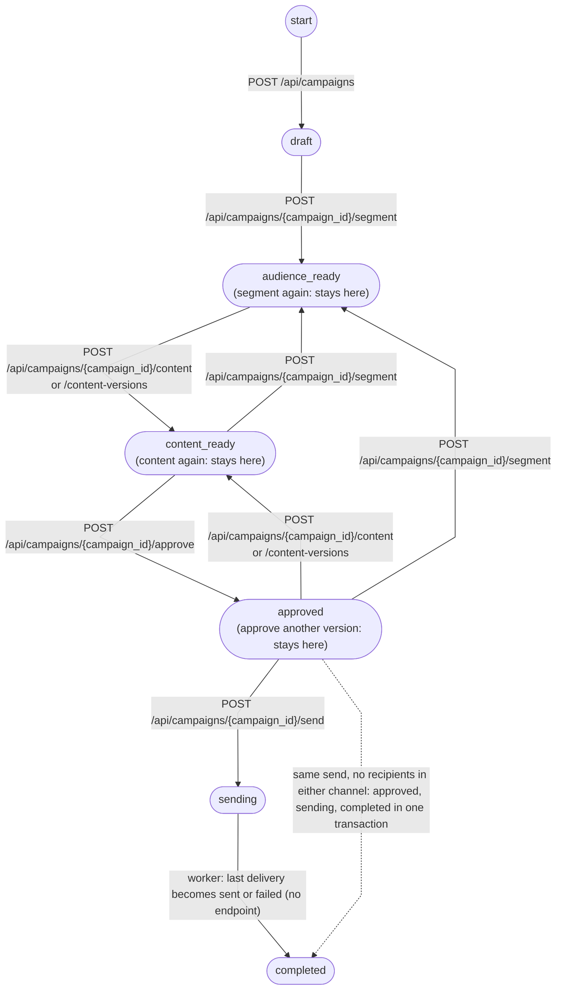

# Smart Campaign Composer

A marketer writes what they want in plain language. Claude suggests the audience and the SMS and email text. A human checks and approves. Approved messages go out through a queue, and you can watch the delivery live.

| | |
|---|---|
| Frontend | Vue 3 (Vite, TypeScript, Pinia, shadcn-vue, Tailwind CSS) |
| Backend | Go |
| LLM | Claude API, or a mock LLM when there is no key |
| Database and queue | PostgreSQL |

The headings below follow the case document. Reasons behind each decision (D1, D2, ...) are in [`DECISIONS.md`](DECISIONS.md).

## Setup

You need Docker (Compose v2.24 or later) and make.

```sh
cp .env.example .env   # optional, everything works without it
docker compose up      # database, seed, api, worker, mock provider, web UI
make test              # all tests, in containers, no API key
make help              # other commands
```

Then open <http://127.0.0.1:8081>. If a port is taken, set `WEB_PORT` (and `API_PORT`) in `.env`.

- **With a key:** put `ANTHROPIC_API_KEY` in `.env` and the real Claude (`claude-sonnet-5-5`) is used.
- **Without a key:** the mock LLM is used. It ignores the brief and always returns the same example audience and text.
- `LLM_PROVIDER=mock` forces the mock even when a key exists. `LLM_PROVIDER=real` fails at start-up without a key.
- To contribute code, run `make hooks` first (needs lefthook and gitleaks).

## Business context

Preparing a campaign means choosing an audience, writing text for each channel and keeping to the length limits. Here the marketer only describes the goal. Claude proposes, a human decides.

Nobody real is messaged: recipients are fake seeded users and messages go to our own mock provider. There is no login (local demo, bound to `127.0.0.1`).

## User flow

Example brief (the UI is in Turkish, so the brief is too): *"Son 30 günde sepetine ürün ekleyip alışveriş yapmayan İstanbul'daki kullanıcılara %30 indirim hatırlatması gönder. Samimi ama kısa olsun."*

1. **Audience.** Claude turns the brief into a segment rule. The screen shows how many people match and how many can be reached by SMS and by email.
2. **Text.** Claude writes the SMS and email text, which streams onto the screen.
3. **Approval.** The marketer previews, edits and approves. Editing after approval removes the approval.
4. **Send.** "Gönder" puts the messages in the queue and the worker sends them to the mock provider.
5. **Tracking.** The screen shows sent, waiting and failed counts live. Failed deliveries can be listed.

The screens work on phone, tablet and desktop widths.

A campaign moves through these states. There is no campaign-level error state; failed messages show up in the counts (D4).



## Functional requirements

**Audience**
- **LLM output is never run as SQL (D8).** The rule uses a closed set of fields, operators and value types. The backend checks it against a schema and builds the query itself.
- **Consent is checked by the system, not the model (D9).** SMS and email consent are separate. A person without consent for a channel is left out of that channel.
- "Did not buy" means no purchase in the last 30 days (D20).

**Content**
- **Limits:** SMS up to 160 characters, email subject up to 80 (body 5000, brief 2000). They are checked after the variables are filled in, using the longest value in the audience (D10, D37).
- **Variables:** `{{first_name}}`, `{{last_name}}`, `{{city}}`. An unknown variable is rejected. An empty first name becomes "Değerli müşterimiz" ("Dear customer").
- Every edit is a new version. Two edits at once are caught with `X-Expected-Version` (D38, D40).

**Delivery**
- **Queue in PostgreSQL (D1, D2).** Each message is a row in `deliveries`. The worker claims rows with `FOR UPDATE SKIP LOCKED`.
- **At most 100 messages per second per channel (D5).** One dispatcher per channel (advisory lock) with a token bucket.
- **No duplicates (D3).** `UNIQUE(campaign_id, channel, customer_id)` plus the same `Idempotency-Key` on every attempt.
- **Retries (D6).** Up to 5 attempts. On 5xx, 408 and timeouts: exponential backoff with jitter (1 s to 60 s). Other 4xx are not retried. 429 follows `Retry-After` with its own budget (20 times or 10 minutes). A delivery that runs out of attempts becomes `failed`.

**Tracking**
- **Live status** over SSE (`/api/campaigns/{id}/events`), no page refresh (D54).
- **Health and metrics** on the API port (default 8080): `/healthz`, `/readyz`, `/metrics` ([`docs/contracts/metrics.md`](docs/contracts/metrics.md)).
- API reference: [`docs/contracts/openapi.yaml`](docs/contracts/openapi.yaml). CI checks that the API matches it (D30).

## AI requirements

- **Validation (D7, D23).** Claude answers in structured JSON through tool use, never free text. The backend checks it again against the full schema. If it is invalid, the errors go back to the model for one more try. If it is still invalid, the user sees a clear error and nothing changes.
- **Testing without a key (D11).** LLM access sits behind the `LLMClient` interface. `make test` and `docker compose up` run with the mock LLM. Its scenarios also cover invalid output and the repair round.

## Resources

- **API key:** read only from `ANTHROPIC_API_KEY` in `.env`. `.env` is never committed, and hooks and CI scan for leaks.
- **Fake users (D21, D24):** 5000 customers with name, email (`example.com`), fake phone, city (30% Istanbul), language, loyalty tier, separate SMS and email consent, and cart, page view and purchase events ([`docs/contracts/seed.md`](docs/contracts/seed.md)). The seed is made relative to the first start date, so "last 30 days" counts shrink as days pass. To remake it relative to today (this deletes campaigns and deliveries): `docker compose run --rm seed seed --ref-time=now --reset --manifest=/tmp/manifest.json`.
- **Mock SMS/email provider (D25, D61):** a separate service with a rate limit, random errors, 429 responses and 20-200 ms delay. For the demo, `compose.yml` sets 40% errors and 10% 429, so retries are visible and about 1% of deliveries end as `failed`. Tests do not use these rates.

## Technology and architecture

```mermaid
flowchart LR
  browser["browser"]
  web["web (Vue + nginx)<br/>127.0.0.1:8081"]
  api["api<br/>127.0.0.1:8080"]
  llm["LLMClient<br/>Claude API or mock LLM"]
  db[("PostgreSQL 16<br/>including the queue")]
  migrate["migrate"]
  seed["seed<br/>5000 fake customers"]
  worker["worker<br/>one dispatcher per channel"]
  mock["mockprovider<br/>:8090"]

  browser -- "http" --> web
  web -- "/api/ proxy_pass" --> api
  api -- "content stream and live status (SSE)" --> web
  api --> llm
  api --> db
  migrate --> db
  seed --> db
  worker -- "claim jobs with SKIP LOCKED, write results" --> db
  worker -- "≤100/s, retry" --> mock
  migrate -.->|"first"| seed
  seed -.->|"first"| api
  seed -.->|"first"| worker
```



- **api:** campaign, audience, content, approval and send endpoints; SSE for content and live status.
- **worker:** works through the queue with rate limiting and retries.
- **web:** the Vue UI. nginx forwards `/api` to the api. Look and feel: [`DESIGN.md`](DESIGN.md).
- **Generation lock (D41, D52):** two generations cannot run on one campaign, and sending waits while one is running.

## Deliverables

| Requested | Status |
|---|---|
| GitHub repository | ✅ `gulcint/smart-campaign-composer` (public) |
| `docker compose up`, seed and mock provider included | ✅ |
| `make test` | ✅ Go and Vitest tests in containers, no key |
| `README.md` | ✅ this file |
| `DECISIONS.md` | ✅ [`DECISIONS.md`](DECISIONS.md) |
| `ai-sessions/` | ✅ P0-P6, sanitized ([`ai-sessions/INDEX.md`](ai-sessions/INDEX.md)) |

Work was done in phases ([`docs/PLAN.md`](docs/PLAN.md)): P0 setup, P1 contracts, P2 seed and infrastructure, P3 audience, P4 content and approval, P5 send and tracking, P6 hardening and delivery are done. P7 (bonus, scheduled send) is in progress.

## Bonus

| Bonus | Status |
|---|---|
| CI pipeline | 🟢 done: GitHub Actions; `main` needs a green `ci-ok` (lint, `make test`, gitleaks, govulncheck, API contract check) |
| Scheduled send | 🟡 in progress (D62): scheduled with `POST /send` plus an optional `scheduled_at`, cancelled with `DELETE .../schedule`; contracts are written, code is next |
| A/B variants | ⬜ not done |
| Content in the user's language | ⬜ not done (the seed already has a `language` field) |

The priority was a solid core flow.

## AI tooling

The project was built with Claude Code, using agents with separate roles ([`docs/PLAN.md`](docs/PLAN.md) §3, D13):

- The **orchestrator** splits the work and merges results.
- The **test writer** writes tests only from [`docs/requirements.md`](docs/requirements.md) and cannot see the implementation (separate worktree and a hook, D50).
- The **implementer**, **reviewer** and **verifier** are separate; nobody approves their own work.
- Hooks (commit format, secret scan, role paths) and CI check everything. Only PRs with a green `ci-ok` reach `main` (D15, D33).

Session exports are in [`ai-sessions/`](ai-sessions/INDEX.md), cleaned of keys and personal data (`make sanitize-sessions`, `make check-sessions`).

## Where to look per evaluation criterion

| Criterion | Where to look |
|---|---|
| LLM integration | `internal/llm/`, [`docs/contracts/schemas/llm/`](docs/contracts/schemas/llm/), D7-D12, D23, D32 |
| Architecture and decisions | [`DECISIONS.md`](DECISIONS.md), [`docs/contracts/`](docs/contracts/README.md) |
| Backend reliability | `internal/delivery/`, `internal/postgres/`, `cmd/worker/`; D1-D6, D52-D54 |
| Frontend | `web/src/`, [`DESIGN.md`](DESIGN.md), [`docs/contracts/ui.md`](docs/contracts/ui.md) |
| Tests and code quality | `test/`, `internal/**/*_test.go`, `web/tests/`, `.github/workflows/`, [`docs/requirements.md`](docs/requirements.md) |

## Known limits

- **Clocks:** the generation lock is a lease of up to 120 s; clock differences between API processes shift its expiry (D52).
- **Lost channel lock:** the old sender may finish one more batch (50 messages) before it notices. The same message still never goes out twice (D53).
- **Live stream:** after 5 failed reads (about 5 s) the screen shows `stale` and reconnects; counters can be a few seconds old (D54).
- **Send speed:** about 50/s per channel in a manual trial, under the limit of 100. There is no automated speed test.
- **Length check at send time:** it checks SMS and email together for one person. If the SMS gets too long after personalization, that person's email also fails with `content_too_long`, and the reverse. A per-channel check needs a contract change.
- **SMS length** is counted in characters. A real SMS segment is 70 characters when the text has Turkish letters (D10).
- **Email body limit** (5000) is checked at validation only, not again at approval (D46).
- **Brief** cannot be changed after creation; "Brief'i düzenle" starts a new campaign.
- **De-duplication is per customer:** two customers with the same phone or email each get a message (D3).
- **Scale:** audience rows are loaded into Go and the queue lives in PostgreSQL. Fine for 5000 users, not for millions (D1).
- **Tests:** they come only from `docs/requirements.md` (D50), so some behaviour written only in the contracts is untested. The real Claude client has no automated test; city spelling and SMS length were checked by hand.
- **UI:** large touch targets depend on screen width, not on touch input. The content screen's action bar is not sticky on mobile.

## Where to read

- [`DECISIONS.md`](DECISIONS.md): decisions and reasons
- [`docs/PLAN.md`](docs/PLAN.md): phases, git flow, roles
- [`docs/requirements.md`](docs/requirements.md): requirements
- [`docs/contracts/`](docs/contracts/README.md): API, data and LLM contracts
- [`DESIGN.md`](DESIGN.md): visual system and screens
- [`ai-sessions/INDEX.md`](ai-sessions/INDEX.md): session records
- [`CLAUDE.md`](CLAUDE.md): project rules and agent instructions
