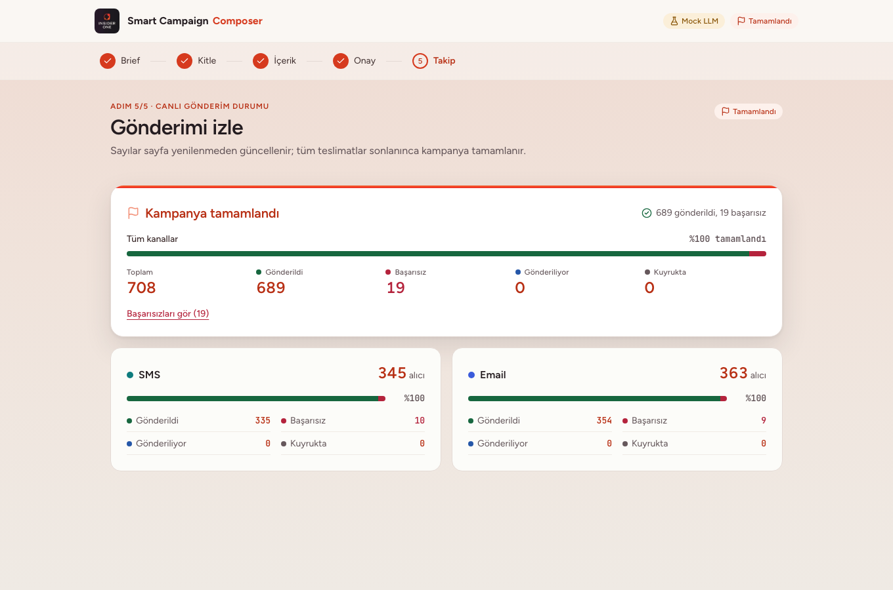
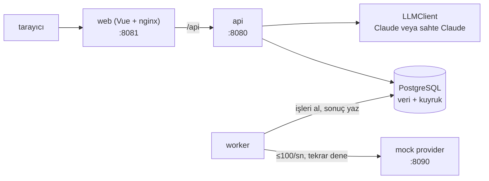

# Smart Campaign Composer

Pazarlamacı ne istediğini doğal dille yazar. Claude hedef kitleyi ve SMS ile email metnini önerir, son kararı insan verir. Onaylanan mesajlar bir kuyruktan sahte (mock) bir servise gönderilir ve gönderim ekranda canlı izlenir.

**Gerçek kimseye mesaj gitmez.** Alıcılar sahte kullanıcılardır, gönderim bizim yazdığımız mock servise yapılır.

## Durum

| | |
|---|---|
| Çekirdek akış (kitle → mesaj → onay → gönderim → izleme) | ✅ Tamam |
| API key olmadan çalışma (sahte Claude devreye girer) | ✅ Tamam |
| Bonus: zamanlanmış gönderim | ✅ Tamam |
| Bonus: CI pipeline | ✅ Tamam |
| Bonus: A/B varyantları | ⬜ Yapılmadı |
| Bonus: kullanıcının diline göre içerik | ✅ Yapıldı (P8: Türkçe ana metin + kitlede İngilizce alıcı varsa İngilizce sürüm; alıcı diline göre gönderim, D63) |

Kullanılan teknolojiler: Vue 3 (arayüz), Go (backend), Claude API, PostgreSQL (veritabanı ve kuyruk).

## Nasıl çalıştırılır

**Önkoşullar**
- **Docker** ve **Docker Compose v2** (`docker compose` komutu). Docker çalışır durumda olmalı; Docker Desktop kullanıyorsan uygulamayı açık tut.
- **make**. Yalnızca `make test` ve `make help` için gerekir.
- **API key gerekmez.** Key yoksa sistem sahte Claude ile çalışır.

**1. Projeyi klonla ve klasöre gir**

```sh
git clone https://github.com/gulcint/smart-campaign-composer.git
cd smart-campaign-composer
```

Komutları klonlanan klasörün içinde çalıştır; başka klasörde `docker compose up` `no configuration file provided` hatası verir.

**2. (İsteğe bağlı) `.env` dosyasını hazırla**

```sh
cp .env.example .env
```

- `ANTHROPIC_API_KEY`: boş bırakırsan sahte Claude kullanılır. Sahte Claude brief'i okumaz; hep aynı örnek kitleyi ve metni döner. Gerçek Claude için key'i buraya yaz.
- `LLM_PROVIDER`: `auto` (varsayılan) key varsa Claude'u, yoksa sahte Claude'u seçer. `mock` key olsa bile sahteyi zorlar. `real` key yoksa başlamaz.

`.env` dosyası git'e girmez. Dosyayı değiştirdikten sonra `docker compose up` komutunu yeniden çalıştır.

**3. Başlat**

```sh
docker compose up
```

İlk açılışta imajlar derlenir, bu yüzden uzun sürer. Servisler şu sırayla açılır:

| Servis | Ne yapar |
|---|---|
| `db` | PostgreSQL 16'yı açar, `scc` veritabanını ve `scc_migrator`, `scc_app` rollerini oluşturur |
| `migrate` | Tabloları kurar, sonra çıkar |
| `seed` | 5000 sahte kullanıcıyı yükler (ad, email, telefon, şehir, kanal izinleri, sepet ve satın alma geçmişi), sonra çıkar |
| `api`, `worker`, `mockprovider` | API, gönderim işçisi ve sahte SMS/email servisi çalışır |
| `web` | Arayüzü sunar; `/api` isteklerini API'ye yönlendirir |

Veri yalnızca ilk açılışta yüklenir. Sonraki açılışlarda `seed` mevcut veriyi bozmadan çıkar.

`docker compose up` terminalde açık kalır. Ctrl+C ile durdurursun; konteynerler kalır ve aynı komutla devam eder.

**4. Hazır olduğunu kontrol et**

- Arayüz: <http://127.0.0.1:8081>
- Sağlık kontrolü: <http://127.0.0.1:8080/readyz>. `200` ve `"status":"ready"` dönerse API hazırdır. `503` ve `not_ready` dönerse veritabanı henüz hazır değildir; birkaç saniye bekleyip tekrar dene.
- `docker compose ps -a` çıktısında `migrate` ve `seed` `exited (0)`, diğer servisler `running` görünmelidir.

**`port is already allocated` hatası alırsan:** 8080 başka bir programda kullanılıyordur. `API_PORT=18080 docker compose up` ile başlat; sağlık kontrolü o zaman <http://127.0.0.1:18080/readyz> olur. Arayüz portu doluysa `WEB_PORT=18081` de ekle.

**5. Testleri çalıştır**

```sh
make test
```

Testler kendi konteynerlerinde, ayrı geçici bir veritabanıyla çalışır (Compose projesi `scc-test`). Geliştirme veritabanına dokunmaz, port de yayımlamaz; yani arayüz açıkken de çalışır.

**Durdurma**

```sh
docker compose down      # konteynerleri durdurur ve kaldırır; veri korunur
docker compose down -v   # ayrıca veritabanı volume'unu (pgdata) siler
```

`down -v` sonrası bir sonraki `docker compose up` veritabanını ve 5000 sahte kullanıcıyı baştan kurar.

**Denemek için:** aşağıdaki örnek brief'i yapıştır, kitle → metin → onay adımlarını izle, "Gönder"e bas. Takip ekranı "Kampanya tamamlandı" ile bitmeli. Birkaç mesajın başarısız olması normaldir; mock servis bilerek hata verir.

**Ayarlar**
- Port değişkenleri (`API_PORT`, `WEB_PORT`) `.env` içine de yazılabilir.
- Kod geliştirecekseniz önce `make hooks` çalıştırın. Diğer komutlar için `make help`.

**Sorun giderme**
- **`no configuration file provided`:** Komutu klonlanan klasörün dışında çalıştırdın. `cd smart-campaign-composer` yapıp tekrar dene.
- **`port is already allocated`:** Port başka bir programda. Yukarıdaki port notuna bak.
- **Docker komutu bağlanamıyor:** Docker çalışmıyor. Docker Desktop'ı aç ya da Docker servisini başlat.
- **`readyz` `503` dönüyor:** Veritabanı ya da `migrate` hata verdi. `docker compose ps -a` ile durumlara, `docker compose logs migrate seed` ile hatalara bak.
- **Sahte Claude çalışıyor:** `.env` yok ya da `ANTHROPIC_API_KEY` boş. API loglarında `"llm_provider":"mock"` görünür (`docker compose logs api`).
- **Veriyi sıfırlamak istiyorsan:** `docker compose down -v`, ardından `docker compose up`.

## Kullanıcı akışı

Örnek brief (arayüz Türkçe olduğu için brief de Türkçe):

> "Son 30 günde sepetine ürün ekleyip alışveriş yapmayan İstanbul'daki kullanıcılara %30 indirim hatırlatması gönder. Samimi ama kısa olsun."

1. **Kitle:** Claude brief'ten bir segment kuralı çıkarır. Ekran kaç kişinin eşleştiğini, kaçına SMS, kaçına email gidebileceğini gösterir.
2. **Mesajlar:** Claude SMS ve email metnini yazar, metin ekrana akarak gelir.
3. **Onay:** Pazarlamacı önizler, düzenler, onaylar. Onaydan sonra düzenleme yapılırsa onay düşer.
4. **Gönderim:** "Gönder" mesajları kuyruğa koyar, worker bunları mock servise yollar.
5. **Takip:** Gönderilen, bekleyen ve başarısız sayıları canlı görünür.



Kampanya şu durumlardan geçer: `draft` → `audience_ready` → `content_ready` → `approved` → `sending` → `completed`. Kitle ya da metin değişirse kampanya bir önceki uygun duruma döner ve yeniden onay gerekir.

## Case isterleri ve nasıl karşılandı

Kararların gerekçeleri `DECISIONS.md` içinde (D1, D2 … numaralarıyla).

### Kitle
- **Claude'un çıktısı asla SQL olarak çalışmaz.** Claude yalnızca izinli alanlardan, operatörlerden ve değer tiplerinden oluşan bir kural üretir. Backend kuralı şemaya göre doğrular ve sorguyu kendisi kurar (D8).
- **İzin kontrolünü model değil sistem yapar.** SMS ve email izni ayrıdır. İzni olmayan kişiye o kanaldan mesaj gitmez (D9).

### İçerik
- **Limitler:** SMS en fazla 160 karakter, email konusu en fazla 80. Kontrol, değişkenler doldurulduktan sonra, kitledeki en uzun değerle yapılır (D10).
- **Kişiselleştirme:** `{{first_name}}`, `{{last_name}}`, `{{city}}`. Bilinmeyen değişken reddedilir. Boş ad "Değerli müşterimiz" olur.
- Her düzenleme yeni bir sürümdür; aynı anda iki düzenleme çakışırsa yakalanır.

### Gönderim
- **Kuyruk PostgreSQL'de.** Her mesaj `deliveries` tablosunda bir satırdır (D1, D2).
- **Kanal başına saniyede en fazla 100 mesaj.** Her kanal için tek bir gönderici çalışır (D5).
- **Aynı kişiye aynı mesaj iki kez gitmez.** Tabloda kampanya + kanal + alıcı tekil, mock servise de her denemede aynı `Idempotency-Key` gider (D3).
- **Tekrar deneme (D6):** en fazla 5 deneme. Sunucu hatası ve zaman aşımında artan bekleme (1–60 sn); 429'da `Retry-After`'a uyulur; diğer 4xx tekrar denenmez. Hakkı biten mesaj `failed` olur.

### Takip
- Canlı durum sayfa yenilemeden akar (SSE).
- `/healthz`, `/readyz` ve `/metrics` endpoint'leri API portundadır.
- API tanımı: [`docs/contracts/openapi.yaml`](docs/contracts/openapi.yaml).

### AI gereksinimleri
- **Doğrulama:** Claude serbest metin değil, yapılandırılmış JSON döner (tool use). Backend bunu tekrar doğrular. Geçersizse hatalar modele geri gönderilip bir kez daha denenir; yine geçersizse kullanıcıya anlaşılır bir hata gösterilir ve hiçbir şey değişmez (D7, D23).
- **Key'siz test:** Claude erişimi bir arayüzün (`LLMClient`) arkasındadır. Testler ve `docker compose up` sahte Claude ile çalışır; geçersiz çıktı senaryoları da sahtede vardır (D11).

### Destek bileşenleri
- **Sahte kullanıcılar:** 5000 kişi; ad, email, telefon, şehir, dil, sadakat seviyesi, ayrı SMS/email izinleri, sepet ve satın alma geçmişi ([`docs/contracts/seed.md`](docs/contracts/seed.md)).
- **Mock SMS/email servisi:** ayrı bir servis; rastgele hata, 20–200 ms gecikme ve 429 döner. Demoda %40 hata ve %10 429 ayarlıdır, bu yüzden tekrar denemeler görünür. Testler bu oranları kullanmaz.
- **API key** yalnızca `.env` içinden okunur; `.env` repoya girmez, hook'lar ve CI sızıntı taraması yapar.

## Mimari



- **api:** kampanya, kitle, içerik, onay ve gönderim uçları; içerik ve canlı durum için SSE.
- **worker:** kuyruğu hız sınırı ve tekrar denemeyle işler.
- **web:** Vue arayüzü ([`DESIGN.md`](DESIGN.md)).
- **migrate / seed:** veritabanını kurar ve sahte kullanıcıları yükler.

## Bilinen sınırlar

Yetiştirilemeyenler ve bilinçli ödünler:

- **A/B varyantları yapılmadı.** Dile göre içerik yalnız `tr` ve `en` içindir; İngilizce sürümün dil kalitesini sistem ölçmez, insan onayı tek güvencedir (D63).
- **Ölçek:** kitle Go belleğine yüklenir, kuyruk PostgreSQL'dedir. 5000 kişi için yeterli, milyonlar için değil (D1).
- **Hız:** elle denemede kanal başına yaklaşık 50 mesaj/sn ölçüldü (limit 100). Otomatik hız testi yok.
- **SMS uzunluğu** karakter olarak sayılır. Türkçe harf içeren gerçek bir SMS parçası 70 karakterdir (D10).
- **Gönderimde uzunluk kontrolü** bir kişinin SMS ve emailini birlikte değerlendirir; biri uzarsa diğeri de `content_too_long` ile düşer.
- **Brief kampanya açıldıktan sonra değişmez;** "Brief'i düzenle" yeni kampanya başlatır.
- **Aynı telefonu/emaili paylaşan iki müşteri** ayrı kişi sayılır, ikisine de mesaj gider (D3).
- **Zamanlanmış gönderim:** worker kapalıyken zamanı geçen plan, worker açılır açılmaz gönderilir. Arayüz yalnızca İstanbul saatiyle plan alır (D62).
- **Canlı akış** kesilirse ekran `stale` gösterip yeniden bağlanır; sayaçlar birkaç saniye eski olabilir (D54).
- **Testler** yalnızca `docs/requirements.md`'den yazıldı (D50). Gerçek Claude istemcisinin otomatik testi yok; şehir yazımı ve SMS uzunluğu elle denendi.

Tüm liste ve gerekçeleri için [`DECISIONS.md`](DECISIONS.md).

## Bonuslar

- **Zamanlanmış gönderim (D62):** onaylı kampanya 1 dakika ile 30 gün sonrasına planlanır; plan değiştirilebilir, iptal edilebilir ya da hemen gönderilebilir.
- **CI (GitHub Actions):** `main`'e girmek için `ci-ok` kontrolü yeşil olmalı (lint, `make test`, gitleaks, govulncheck, API sözleşmesi kontrolü).

## Teslim edilenler

| İstenen | Durum |
|---|---|
| GitHub repo | ✅ `gulcint/smart-campaign-composer` |
| `docker compose up` (seed ve mock dahil) | ✅ |
| `make test` | ✅ key gerekmez |
| `README.md` | ✅ bu dosya |
| `DECISIONS.md` | ✅ [`DECISIONS.md`](DECISIONS.md) |
| `ai-sessions/` | ✅ anahtar ve kişisel bilgiden temizlenmiş ([`ai-sessions/INDEX.md`](ai-sessions/INDEX.md)) |

## Yapay zeka araçlarıyla çalışma şekli

Proje Claude Code ile, ayrı rollere sahip ajanlarla geliştirildi ([`docs/PLAN.md`](docs/PLAN.md)):

- **Orkestratör** işi böler, sonuçları birleştirir.
- **Test yazarı** testleri yalnızca [`docs/requirements.md`](docs/requirements.md)'den yazar, kodu göremez.
- **Kodu yazan, gözden geçiren ve doğrulayan** ayrı rollerdir; kimse kendi işini onaylamaz.
- Hook'lar ve CI her şeyi denetler; `main`'e yalnızca yeşil CI'lı PR'lar girer.

## Nerede ne var

| Konu | Yer |
|---|---|
| LLM entegrasyonu | `internal/llm/`, `docs/contracts/schemas/llm/` |
| Mimari ve kararlar | [`DECISIONS.md`](DECISIONS.md), [`docs/contracts/`](docs/contracts/README.md) |
| Gönderim güvenilirliği | `internal/delivery/`, `internal/postgres/`, `cmd/worker/` |
| Arayüz | `web/src/`, [`DESIGN.md`](DESIGN.md) |
| Testler | `test/`, `internal/**/*_test.go`, `web/tests/`, [`docs/requirements.md`](docs/requirements.md) |
| Plan ve fazlar | [`docs/PLAN.md`](docs/PLAN.md) |
| Proje kuralları | [`CLAUDE.md`](CLAUDE.md) |
