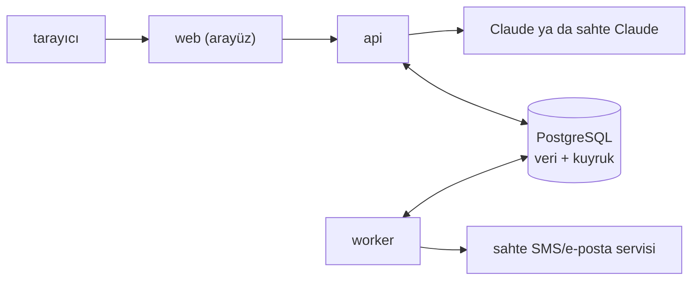

# Smart Campaign Composer

Smart Campaign Composer, pazarlama ekiplerinin kampanyalarını kendi sözleriyle tanımlamasını sağlar. Pazarlamacı ne istediğini yazar; Claude hedef kitleyi ve SMS ile e-posta metinlerini önerir. Son kararı insan verir. Onaylanan mesajlar sahte bir servise gönderilir ve gönderim ekranda canlı izlenir.

**Hiçbir gerçek kişiye mesaj gönderilmez.** Alıcılar sahte kullanıcılardır; gönderim de sahte (mock) bir servise yapılır.

## Kullanılan teknolojiler

- **Ön yüz:** Vue 3 ve TypeScript
- **Arka yüz:** Go
- **Yapay zekâ:** Claude API (API anahtarı yoksa sahte Claude)
- **Veritabanı ve kuyruk:** PostgreSQL
- **Kurulum ve otomasyon:** Docker Compose, GitHub Actions

## Case isterleri

Case dokümanındaki tüm maddeler ve dört bonusun tamamı karşılanmıştır. Kararların gerekçeleri [`DECISIONS.md`](DECISIONS.md) dosyasındadır.

### Kullanıcı akışı

| Adım | Nasıl çalışıyor |
|---|---|
| **Kitle çıkarılır** | Claude, brief'ten bir kitle kuralı çıkarır; ekran kaç kişiye ulaşılacağını gösterir. |
| **Mesajlar üretilir** | SMS ve e-posta metinleri ekrana akarak yazılır. |
| **İnsan onaylar** | Pazarlamacı önizler, gerekirse düzenler ve onaylar; yalnızca onaylanan metin gönderilir. |
| **Gönderilir** | Mesajlar bir kuyruk üzerinden sahte servise iletilir. |
| **Canlı izlenir** | Takip ekranı gönderimi canlı olarak gösterir. |

### Temel kurallar

| Kural | Nasıl sağlanıyor |
|---|---|
| Claude'un yazdığı kural doğrudan çalıştırılmaz | Kitle kuralı yalnızca izin verilen alanlardan oluşur; sistem bunu doğrular ve sorguyu kendisi hazırlar. |
| İzni olmayan kişiye mesaj gitmez | SMS ve e-posta izinleri ayrı ayrı kontrol edilir. |
| Karakter sınırları | SMS en fazla 160, e-posta konusu en fazla 80 karakterdir; ad gibi alanlar doldurulduktan sonra ölçülür. |
| Kişiselleştirme | `{{first_name}}` gibi alanlar desteklenir; bilinmeyen alanlar reddedilir. |
| Gönderim hızı | Her kanalda saniyede en fazla 100 mesaj gönderilir. |
| Tekrar yok | Aynı kişiye aynı mesaj iki kez gitmez; başarısız olanlar sınırlı sayıda yeniden denenir. |
| Takip | Canlı durum, metrikler ve sağlık kontrolü vardır. |

### Yapay zekâ

| Konu | Nasıl sağlanıyor |
|---|---|
| **Doğrulama** | Claude'un cevabı düzenli bir biçimde alınır ve sistem tarafından kontrol edilir. Geçersizse bir kez düzeltme istenir; yine olmazsa anlaşılır bir hata gösterilir. |
| **Test edilebilirlik** | API anahtarı olmadan çalışır: sahte Claude devreye girer. Testler de bu şekilde çalışır. |

### Teslim edilenler

- [x] **GitHub repository:** [`gulcint/smart-campaign-composer`](https://github.com/gulcint/smart-campaign-composer)
- [x] **`docker compose up`** ile tek komutla kurulum (örnek veri ve sahte servis dahil)
- [x] **`make test`** ile çalışan testler (API anahtarı gerekmez)
- [x] **`README.md`:** kurulum ve kısa mimari özeti
- [x] **`DECISIONS.md`:** önemli kararlar ve nedenleri
- [x] **`ai-sessions/`:** temizlenmiş Claude oturum kayıtları ([dizin](ai-sessions/INDEX.md))

### Bonuslar (isteğe bağlı)

- [x] ⏰ **Zamanlanmış gönderim:** kampanya ileri bir tarih ve saate planlanabilir.
- [x] 🧪 **A/B varyantları:** iki farklı mesaj üretilir; kitle gönderimde ikiye bölünür.
- [x] 🌍 **Kullanıcının diline göre içerik:** kitlede İngilizce konuşanlar varsa İngilizce metin de üretilir.
- [x] ⚙️ **CI pipeline:** her değişiklikte testler ve kontroller otomatik çalışır (GitHub Actions).

> **Ek olarak:** brief ekranının altında planlanan ve gönderilen kampanyaların listesi yer alır; takip ekranı yeniden tasarlanmıştır.

## Çalıştırma

Gereksinimler: Docker (çalışır durumda olmalıdır) ve `make`. API anahtarı gerekmez.

**1. Depoyu klonlayın ve klasöre geçin.**

```sh
git clone https://github.com/gulcint/smart-campaign-composer.git
cd smart-campaign-composer
```

**2. (İsteğe bağlı) Gerçek Claude için API anahtarını ekleyin.**

```sh
cp .env.example .env   # ardından ANTHROPIC_API_KEY satırını doldurun
```

Anahtar yoksa sahte Claude çalışır. Sahte Claude brief'i yorumlamaz; her seferinde aynı örnek kitleyi ve metni verir.

**3. Sistemi başlatın.** İlk açılış birkaç dakika sürebilir; 5000 sahte kullanıcı otomatik yüklenir.

```sh
docker compose up
```

**4. Arayüzü açın:** <http://127.0.0.1:8081>. Sistem hazır olduğunda <http://127.0.0.1:8080/readyz> adresi `"status":"ready"` gösterir.

**5. Testleri çalıştırın.**

```sh
make test
```

**Durdurma:** `docker compose down` sistemi durdurur ve verileri korur; `docker compose down -v` verileri de siler.

## Neler denenebilir

Brief ekranındaki **"Örnek brief'i kullan"** düğmesi şu metni doldurur:

> "Son 60 günde alışveriş yapmayan müşterilere %15 indirimle geri dönmeleri için mesaj gönder. Sıcak bir dil kullan."

1. **Kitle:** Claude brief'ten bir kural çıkarır; ekran kaç kişiye ulaşılacağını gösterir.
2. **Mesajlar:** SMS ve e-posta metinleri yazılır. "A/B testi"ni açarak iki farklı mesaj üretebilirsiniz.
3. **Onay:** Metni önizleyin, gerekirse düzenleyin ve onaylayın.
4. **Gönderim:** Hemen gönderin ya da ileri bir tarihe planlayın (saatler UTC+3).
5. **Takip:** Gönderim canlı izlenir ve "Kampanya tamamlandı" ile sona erer. Birkaç mesajın başarısız olması normaldir; sahte servis bilerek hata verir.


## Nasıl çalışır



`api` servisi brief'i Claude'a iletir ve yanıtı doğrular. Onaylanan mesajlar veritabanındaki bir kuyruğa yazılır; `worker` servisi bunları hız sınırına uyarak sahte servise gönderir ve sonuçları kaydeder. Takip ekranı bu sonuçları canlı gösterir.

## Daha fazla bilgi

- [`DECISIONS.md`](DECISIONS.md): kararlar ve nedenleri
- [`docs/PLAN.md`](docs/PLAN.md): geliştirme planı ve süreci
- [`docs/requirements.md`](docs/requirements.md): gereksinimler
- [`docs/contracts/openapi.yaml`](docs/contracts/openapi.yaml): API uç noktaları
- [`docs/contracts/db-schema.md`](docs/contracts/db-schema.md): veri modeli
- [`DESIGN.md`](DESIGN.md): arayüz tasarımı
- [`ai-sessions/INDEX.md`](ai-sessions/INDEX.md): Claude oturum kayıtları
