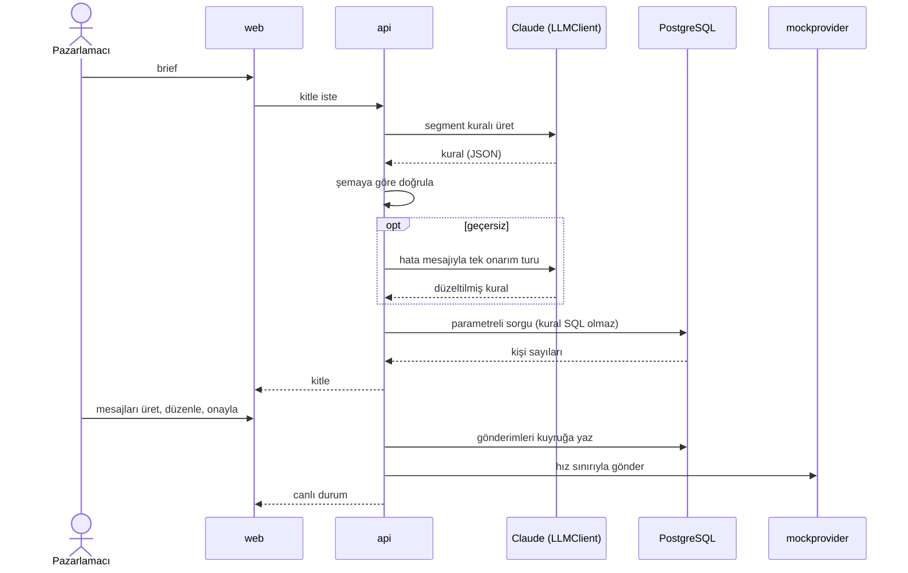
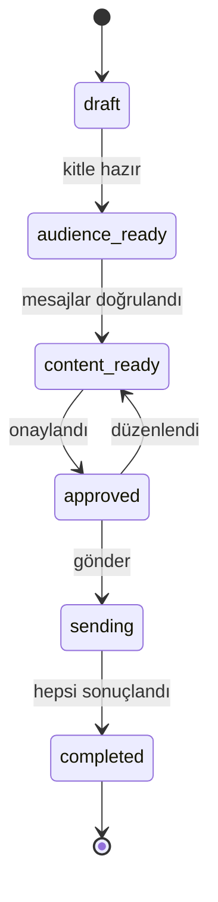
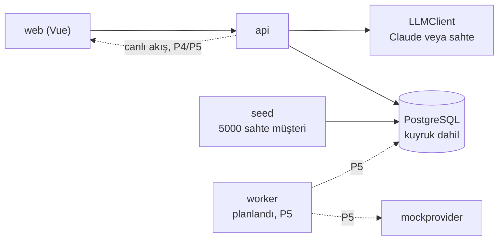

# Smart Campaign Composer

Pazarlamacı ne istediğini doğal dille yazar. Yapay zeka (Claude) hedef kitleyi ve SMS ile email metinlerini önerir, son kararı insan verir. Onaylanan mesajlar bir kuyruktan geçerek gönderilir ve gönderim canlı izlenir.

> "Son 30 günde sepetine ürün ekleyip alışveriş yapmayan İstanbul'daki kullanıcılara %30 indirim hatırlatması gönder. Samimi ama kısa olsun."

Ürün, kampanya hazırlayan pazarlamacılar içindir. Bilerek yapmadıkları: gerçek kimseye mesaj göndermez (alıcılar seed edilmiş sahte kullanıcılardır, gönderim kendi yazdığımız mock provider'adır) ve kimlik doğrulaması yoktur (yerel demo).

## Bir kampanya nasıl ilerler

1. **Brief.** Pazarlamacı isteğini yukarıdaki gibi düz cümleyle yazar.
2. **Kitle.** Claude brief'i bir segment kuralına çevirir (şehir, son 30 gün, sepet gibi alanlar). Arayüz kaç kişinin eşleştiğini, kaçına SMS ve email ile ulaşılabildiğini gösterir. İnsan kitleyi kontrol eder, gerekirse yeniden üretir.
3. **Mesajlar.** Claude SMS ve email metnini yazar; metin ekrana akarak gelir. Sistem uzunluk sınırlarını (SMS 160, email konusu 80 karakter) ve `{{first_name}}` gibi değişkenleri denetler.
4. **Onay.** İnsan metni önizler, düzenler ve onaylar. Onaydan sonra metni değiştirirse onay düşer, yeniden onaylanır.
5. **Gönderim ve izleme.** Mesajlar kuyruğa girer, mock provider'a hız sınırıyla gider; panel gönderilen, bekleyen ve başarısız sayılarını canlı gösterir.

Yapay zekanın çıktısı her adımda denetlenir. Geçersizse hata mesajıyla bir kez daha denenir, yine geçersizse kullanıcıya anlaşılır bir hata gösterilir:



Mesaj üretimi de aynı doğrulama ve tek onarım turunu kullanır. Kampanya şu durumlardan geçer; kampanya düzeyinde hata durumu yoktur, tek tek mesaj hataları sayılarda görünür:



## Parçalar ve neden böyle

Düz çizgi `main`'de çalışan, kesikli çizgi henüz yazılmamış parçadır.



Tasarım fikirleri (gerekçeler ve alternatifler: [`DECISIONS.md`](DECISIONS.md)):

- **Claude serbest metin değil, yapılandırılmış JSON döndürür.** Serbest metni ayrıştırmak kırılgandır. JSON'u şemaya göre doğrulayabilir, hatalıysa modele nedenini söyleyip düzelttirebiliriz.
- **Yapay zekanın çıktısı asla SQL olmaz.** Segment kuralı kapalı bir dildir: izinli alanlar, operatörler, değer tipleri. Backend kuralı doğrular ve kendi koduyla parametreli sorguya çevirir. Böylece model ne yazarsa yazsın veritabanına yetkisiz sorgu gitmez.
- **Kuyruk PostgreSQL'dedir.** Gönderilecek her mesaj bir satırdır; durumu, tekrar denemesi ve "aynı kişiye aynı mesaj iki kez gitmez" kuralı (kampanya, kanal, alıcı tekil) o satırda tutulur. Bu ölçekte ayrı bir kuyruk servisi gereksiz karmaşıklık olurdu.
- **İzni sistem uygular, model değil.** SMS ve email izinleri ayrıdır. İzni olmayan kişi kitle sorgusunda elenir; bunu modelin akıl yürütmesine bırakmak güvence vermez.
- **Sahte LLM ve mock provider vardır.** Anahtar yoksa sahte LLM devreye girer; mock provider rastgele hata, gecikme ve 429 üretir. Böylece testler ve demo anahtarsız çalışır, retry mantığı gerçekten denenir.

## Durum

Faz kapsamları: [`docs/PLAN.md`](docs/PLAN.md). Durum yalnızca koddan, git geçmişinden ve PR'lardan doğrulananlara göre yazıldı.

| Faz | Durum | Kapsam |
|---|---|---|
| P0 Kurulum | ✅ bitti | Repo, hook'lar, CI, plan |
| P1 Sözleşmeler | ✅ bitti | Gereksinimler, OpenAPI, şemalar, arayüz ve Go sözleşmeleri |
| P2 Seed + altyapı | ✅ bitti | Seed, migration'lar, compose, LLM fabrikası ve sahte LLM, mock provider, `make test` |
| P3 Kitle | ✅ bitti | Segment kuralı, kişi sayıları, brief ve kitle ekranları, API'nin sözleşmeden sapmaması için koruma |
| P4 İçerik + onay | ⬜ başlamadı | SMS/email üretimi (SSE), limitler, düzenleme, onay |
| P5 Gönderim + takip | ⬜ başlamadı | Kuyruk, hız sınırı, retry, canlı durum, dashboard |
| P6 Sertleştirme + teslim | ⬜ başlamadı | Uçtan uca test, güvenlik taraması, son README ve DECISIONS |
| Bonus | ⬜ başlamadı | Zamanlanmış gönderim, A/B varyantları, dile göre içerik |

## Çalıştırma

Gereken yalnızca Docker ve make.

```sh
docker compose up   # veritabanı, seed, api, mock provider, web arayüzü
make test           # tüm testler konteynerde, API key'siz
make help           # diğer komutlar
```

Yerelde `.env` dosyasına Claude anahtarı koyarsanız sistem gerçek Claude'u kullanır, koymazsanız sahte LLM çalışır. Örnek: [`.env.example`](.env.example).

Bugün denenebilecek olan: `docker compose up` bitince tarayıcıda <http://127.0.0.1:8081> adresini açın ve örnek brief'i yazın ("Son 30 günde sepetine ürün ekleyip alışveriş yapmayan İstanbul'daki kullanıcılara %30 indirim hatırlatması gönder"); sistem segment kuralını ve kanal başına kaç kişiye ulaşılacağını gösterir. Anahtar yoksa cevabı sahte LLM verir, `.env`'ye anahtar koyarsanız gerçek Claude cevaplar. Henüz yapılamayanlar: mesaj içeriği üretimi ve onay (P4), gönderim ve canlı takip (P5).

## Nereden okunur

- [`DECISIONS.md`](DECISIONS.md): önemli kararlar, gerekçeleri, bilinen sınırlar
- [`docs/PLAN.md`](docs/PLAN.md): fazlar, git akışı, roller
- [`docs/requirements.md`](docs/requirements.md): gereksinim kataloğu
- [`docs/contracts/`](docs/contracts/README.md): API, veri ve LLM araç sözleşmeleri
- [`DESIGN.md`](DESIGN.md): görsel sistem ve ekranlar
- [`ai-sessions/INDEX.md`](ai-sessions/INDEX.md): temizlenmiş Claude session kayıtları
- [`CLAUDE.md`](CLAUDE.md): proje kuralları ve ajan talimatları

## Güvenlik ve sınırlar

- Claude anahtarı yalnızca yerel `.env` dosyasında durur; git'e girmez, hook'lar ve CI sızıntıyı tarar.
- Yapay zeka SQL yazmaz; kural doğrulanır ve parametreli sorguya kod tarafından çevrilir.
- Kanal izni olmayan kişiye o kanaldan mesaj gitmez.
- API ile dokümanı CI aynı tutar: OpenAPI sözleşmedir, testler her istek ve cevabı ona göre doğrular.
- Kimlik doğrulama yoktur; sistem yerel demo olarak yalnızca `127.0.0.1`'e açılır.
- Henüz yok: mesaj üretimi ve onay (P4), gönderim ve canlı panel (P5), uçtan uca test ve güvenlik taraması (P6).
- Bonuslar (zamanlanmış gönderim, A/B varyantları, dile göre içerik) başlamadı. Gerçek Claude istemcisi için otomatik test yoktur, elle doğrulandı ([`DECISIONS.md`](DECISIONS.md)).
