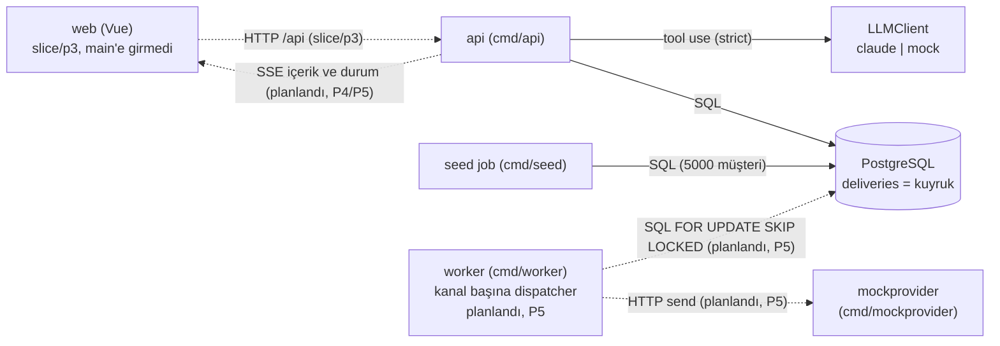
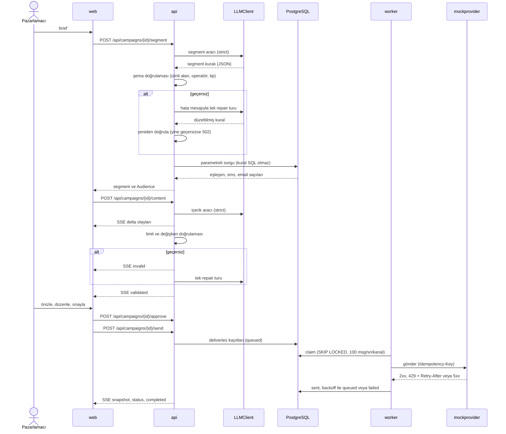
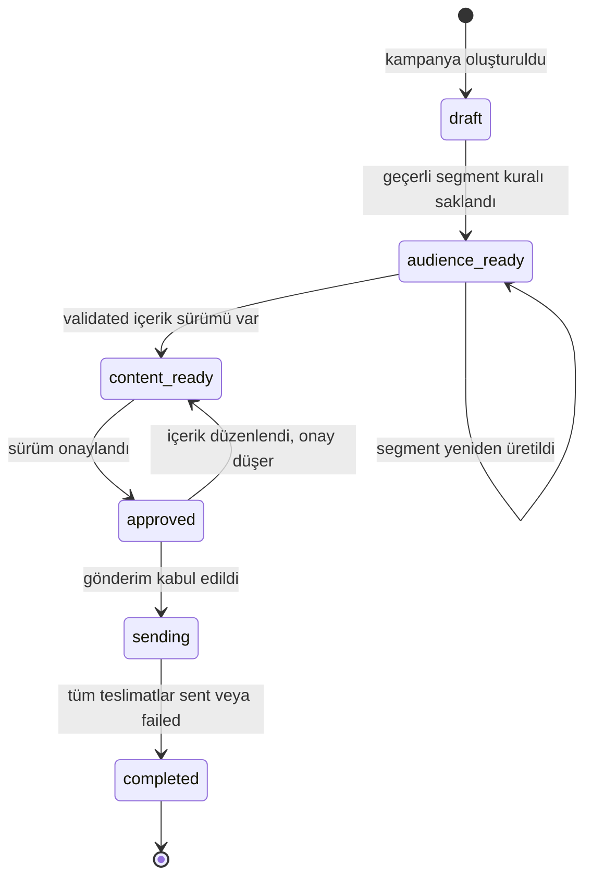

# Smart Campaign Composer

Pazarlamacı ne istediğini doğal dille yazar (ör. "Son 30 günde sepetine ürün ekleyip alışveriş yapmayan İstanbul'daki kullanıcılara %30 indirim hatırlatması gönder"). Claude brief'ten yapılandırılmış bir segment kuralı ve SMS/email içeriği önerir; backend her çıktıyı şemaya göre doğrular; insan önizler, düzenler ve onaylar. Onaylanan mesajlar PostgreSQL tabanlı bir kuyruk üzerinden mock provider'a gider, dashboard gönderim durumunu canlı gösterir. Alıcılar seed edilmiş sahte kullanıcılardır; gerçek kimseye mesaj gitmez.

Bu README `origin/main` (`p2-done` etiketi, commit `21fd076`) durumuna göre yazıldı. P3 henüz `main`'de değil, ayrı bir entegrasyon branch'inde (`slice/p3-audience`).

## Durum

Durum yalnızca koddan, git geçmişinden veya PR'lardan doğrulananlara göre yazıldı. Faz kapsamları ve kapı koşulları: [`docs/PLAN.md`](docs/PLAN.md) §1.1. Gereksinimler: [`docs/requirements.md`](docs/requirements.md).

| Faz | Durum | Kapsam | REQ | Kanıt |
|---|---|---|---|---|
| P0 Kurulum | ✅ bitti | Repo, hook'lar, CI iskeleti, plan | - | PR #1, #2; `p0-done` |
| P1 Sözleşmeler | ✅ bitti | Gereksinim kataloğu, OpenAPI, şemalar, Go arayüz imzaları, UI sözleşmesi, `DECISIONS.md` | tümü (katalog) | PR #3-#8; `docs/contracts/` |
| P2 Seed + altyapı | ✅ bitti | Seed + manifest, migration'lar, compose, health/metrics, LLM fabrikası (auto/real/mock), mock LLM, gerçek Claude istemcisi, mock provider, `make test` altyapısı | REQ-DLV-01/02, REQ-AI-02/03/04/05, REQ-TRK-03, REQ-SEC-02, REQ-SEED-01/02 | PR #9-#14 (`feat/p2-foundation` #9, testler #11, slice #14); `p2-done`; testler `internal/seed`, `internal/llm`, `internal/config`, `internal/health`, `internal/postgres`, `test/e2e` |
| P3 Kitle | 🟡 kısmen | Segment kuralı üretimi, doğrulama, parametreli sorgu, kanal bazında kişi sayısı, brief ve kitle ekranları | REQ-AUD-00..05, REQ-AI-01 (segment) | `main`'de yok. `slice/p3-audience` içinde backend PR #19 (`internal/segment` Parse/Validate/Compile, `internal/postgres/audience.go`, `POST /api/campaigns`, `POST /api/campaigns/{id}/segment`, `POST /api/segments/count`) ve web PR #20 (Vue uygulaması `web/`, `web` compose servisi, CI) merge edildi. Eksik: bu faza ait testler yazılıyor (slice'ta segment/composer/web testi yok), `internal/composer` içinde segment üretimi ve tek repair denemesi (`GenerateSegment`) yazılı; içerik akışı P4'te, faz kapısı ve `main`'e merge yok |
| P4 İçerik + onay | ⬜ başlamadı | SMS/email üretimi (SSE stream), limitler, kişiselleştirme, düzenleme, sürümlü onay | REQ-CNT-01..05, REQ-APR-01..03, REQ-UI-01 | `internal/content`, `internal/sse` yalnızca iskelet; `/content`, `/approve` uçları yok |
| P5 Gönderim + takip | ⬜ başlamadı | `deliveries` dispatcher'ı, hız sınırı, retry, idempotency, canlı durum SSE, dashboard | REQ-SND-01..05, REQ-TRK-01/02, REQ-SEC-01 | `cmd/worker` yok; `internal/delivery` yalnızca `RetryConfig`; `internal/provider` yalnızca hata sabitleri |
| P6 Sertleştirme + teslim | ⬜ başlamadı | Uçtan uca test, güvenlik taraması, README/DECISIONS son hali, session export'ları | REQ-DLV-03/04 | Bu README ilk taslaktır; `ai-sessions/` P0-P2 için dolu |
| Bonus | ⬜ başlamadı | Zamanlanmış gönderim, A/B varyantları, dile göre içerik | - | Yazılmadı. CI pipeline'ı çalışıyor: [`.github/workflows/ci.yml`](.github/workflows/ci.yml) |

Mock provider (`cmd/mockprovider`, `internal/mockprovider`) kataloğa göre P5 işi ama P2'ye çekildi ve `main`'de çalışıyor (DECISIONS D25). Bağlı olduğu `REQ-MOCK-01/02` testleri ve dispatcher P5'te gelecek.

## Hızlı başlangıç

Gereken: Docker ve make. Go ve Node host'ta gerekmez.

```sh
docker compose up
```

- `main`'de ayağa kalkanlar: `db`, `migrate`, `seed` (5000 sahte müşteri), `api`, `mockprovider`. Yalnızca `api` host'a açılır: `127.0.0.1:8080` (`/healthz`, `/readyz`, `/metrics`, `GET /api/config`). Web arayüzü `main`'de yok; `slice/p3-audience` içinde ayrı `web` servisi var.
- Key yoksa `LLM_PROVIDER=auto` mock LLM'i seçer. Yerelde `.env` içinde `ANTHROPIC_API_KEY` doluysa compose gerçek Claude istemcisini seçer ([DECISIONS D29](DECISIONS.md)); key'siz denemek için o satırı boşaltın.
- Gerçek Claude API'si strict araçlar için elle doğrulandı (D23). Segment/içerik repair turu da orkestratör tarafından 2026-10-27'de elle doğrulandı; bunun için otomatik test yok.

```sh
make test   # tüm testler konteynerde, API key'siz (yalnızca Docker + make)
make help   # hedef listesi
```

Diğer hedefler (`test-unit`, `test-integration`, `lint`, `db-roundtrip`, `secrets` vb.) `make help` çıktısındadır. Henüz çalışmayan: gönderim ve takip uçları, içerik üretimi, onay (P4/P5).

## Mimari

Üç şemada düz çizgi `main`'de olan, "slice/p3" etiketli olan yalnızca `slice/p3-audience` branch'inde olan, kesikli çizgi henüz yazılmamış parçadır.

### Bileşenler



`api`, `db`, `seed`, `LLMClient` ve `mockprovider` `main`'de çalışır. `web` ve `api`'nin segment uçları yalnızca `slice/p3-audience`'tadır; SSE akışları ve `worker` hiçbir yerde yazılmadı. `LLMClient` anahtar yoksa mock, varsa gerçek Claude istemcisini döndürür (`internal/llm/factory.go`). Kuyruk ayrı bir servis değildir: `deliveries` tablosu kuyruk, durum ve tekillik (`UNIQUE(campaign_id, channel, customer_id)`) işini yapar ([DECISIONS D1](DECISIONS.md)).

### Kullanıcı akışı

Hedef akış; kutular hangi adımın hangi fazda geldiğini göstermez, o bilgi durum tablosundadır. Bugün `main`'de bu akışın hiçbir adımı çalışmaz; segment adımı slice'tadır.



Her LLM çıktısı (segment ve içerik) doğrulamadan geçmeden kullanılmaz; geçersizse hata mesajıyla bir kez tekrar denenir, ardından kullanıcıya anlamlı hata döner ([`docs/contracts/llm-tools.md`](docs/contracts/llm-tools.md), [DECISIONS D7](DECISIONS.md)). Retry: 429'da `Retry-After`'a uyulur, 5xx/timeout'ta üstel backoff + jitter, 5. başarısız denemede `failed` ([DECISIONS D6](DECISIONS.md)). Uç adları [`docs/contracts/openapi.yaml`](docs/contracts/openapi.yaml)'dandır.

### Kampanya durum makinesi



Kampanya düzeyinde `failed` durumu yoktur: tek tek teslimat hataları `failed` teslimat sayılır, kampanya yine `completed` olur ([DECISIONS D4](DECISIONS.md), [`docs/requirements.md`](docs/requirements.md) "Kampanya durum makinesi"). Durum adları `internal/campaign/campaign.go` içindedir. `sending` ve `completed` durumunda içerik düzenleme 409 döner.

## Önemli dosyalar

| Yol | Açıklama |
|---|---|
| [`CLAUDE.md`](CLAUDE.md) | Proje kuralları ve Claude Code için çalışma talimatı |
| [`DECISIONS.md`](DECISIONS.md) | Kararlar ve gerekçeleri, bilinen sınırlar |
| [`DESIGN.md`](DESIGN.md) | Görsel sistem, token'lar, ekranlar |
| [`docs/PLAN.md`](docs/PLAN.md) | Fazlar, git akışı, hook'lar, roller |
| [`docs/requirements.md`](docs/requirements.md) | REQ kataloğu ve kabul ölçütleri |
| [`docs/contracts/`](docs/contracts/README.md) | Sözleşmeler: `openapi.yaml`, `db-schema.md`, `segment-dsl.md`, `sse-events.md`, `llm-tools.md`, `go-interfaces.md`, `mock-provider.md`, `seed.md`, `metrics.md`, `ui.md` |
| [`ai-sessions/`](ai-sessions/INDEX.md) | Temizlenmiş Claude session export'ları ve dizin (`INDEX.md`) |
| [`migrations/`](migrations/) | Altı migration (up/down çifti) |
| [`testdata/seed/manifest.json`](testdata/seed/manifest.json) | Seed'in beklenen sayıları (seed kodu üretir) |
| [`test/`](test/) | Paylaşılan test altyapısı ve E2E (`e2e`, `repo`, `testdb`, `testenv`); birim testleri paketlerin yanında |
| [`compose.yml`](compose.yml), [`compose.test.yml`](compose.test.yml) | Sistem ve test ortamı |
| [`Makefile`](Makefile) | Komutlar (`make help`) |
| [`.env.example`](.env.example) | Ortam değişkenleri |
| [`scripts/`](scripts/) | Hook'lar, ajan guard'ları, migration gidiş-dönüş, session temizleyici |
| [`.github/workflows/ci.yml`](.github/workflows/ci.yml) | CI; `main` için `ci-ok` zorunlu |

## Güvenlik notları

- `ANTHROPIC_API_KEY` yalnızca yerel `.env`'de durur; repoda `.env.example` vardır, `.env` git'e giremez. CI ve hook'lar key desenlerini tarar (`make secrets`, `make check-sessions`).
- LLM çıktısı asla SQL olarak çalıştırılmaz: segment kuralı kapalı bir DSL'dir, backend şemaya göre doğrular ve parametreli sorguya kendi kodu çevirir ([`docs/contracts/segment-dsl.md`](docs/contracts/segment-dsl.md), D8).
- Kanal izni olmayan kullanıcıya o kanaldan mesaj gitmez; SMS ve email izinleri ayrıdır ve filtre sistem tarafında uygulanır (D9).
- Uygulama veritabanı rolü (`scc_app`) en az yetkilidir; migration rolü ayrıdır (REQ-SEC-02).
- Kimlik doğrulama yoktur: yerel demo. Compose portları yalnızca `127.0.0.1`'e açılır; `/metrics` de yayınlanan API portundadır (D28).

## Yetiştirilemeyenler ve bilinen sınırlar

`main` durumuna göre henüz olmayanlar:

- P3 `main`'e girmedi; testleri ve faz kapısı bekliyor; içerik üretim akışı (`internal/composer`, SSE) P4'te gelecek.
- İçerik üretimi, SSE yayını, onay ve sürümleme (P4).
- Gönderim: dispatcher/worker, hız sınırı, retry, idempotency, canlı dashboard (P5).
- Uçtan uca test, güvenlik taraması, teslim kontrol listesi (P6).

Bonuslar (çekirdek akış sağlam olunca): zamanlanmış gönderim, A/B varyantları, kullanıcının diline göre içerik. Hiçbiri başlamadı.

Bilinen sınırlar ([DECISIONS.md](DECISIONS.md) "Bilinen sınırlar"):

- SMS uzunluğu karakter (rune) sayısıyla ölçülür; GSM-7/UCS-2 segment sayısı hesaplanmaz (D10).
- Gerçek Claude istemcisi için otomatik test yoktur; sözleşme gerçek istemciyi test binary'sinde yasaklar. Doğrulama elle yapıldı.
- Brief güncellenemez; "brief'i düzenle" yeni kampanya başlatır.
- Kuyruk PostgreSQL'dedir; milyonlarca mesaj için `Queue` arayüzü arkasında değişim gerekir (D1).
