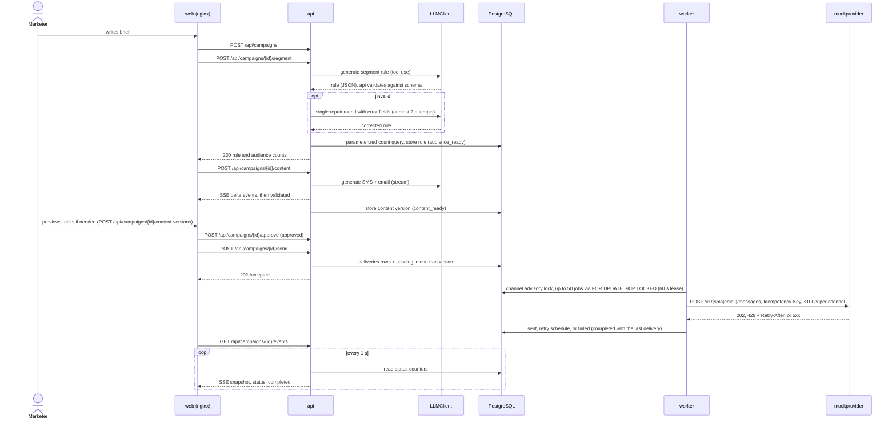
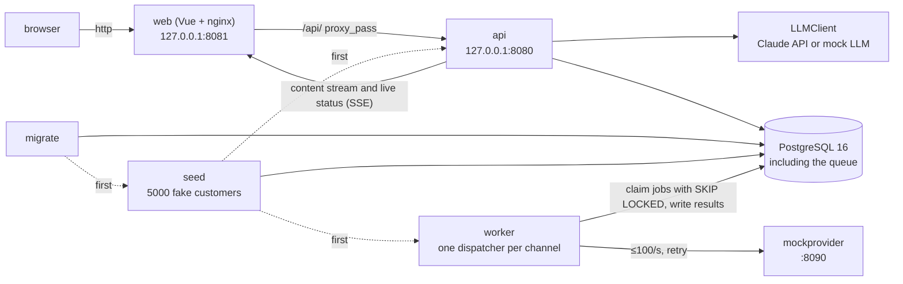

# Smart Campaign Composer

The marketer writes what they want in plain language. Claude proposes the target audience and the SMS and email copy, and a human makes the final decision. Approved messages go out through a queue, and delivery is tracked live.

| | |
|---|---|
| Frontend | Vue 3 (Vite, TypeScript, Pinia, shadcn-vue + Tailwind CSS v4) |
| Backend | Go |
| LLM | Claude API (Anthropic Go SDK); a mock LLM when there is no key |
| Database and queue | PostgreSQL |

This README follows the headings of the case document: under each one it says how the requirement is met and where the detail lives. The rationale and alternatives for each decision are in [`DECISIONS.md`](DECISIONS.md).

## Contents

- [Setup](#setup)
- [Business context](#business-context)
- [User flow](#user-flow)
- [Functional requirements](#functional-requirements)
- [AI requirements](#ai-requirements)
- [Resources](#resources)
- [Technology and architecture](#technology-and-architecture)
- [Deliverables](#deliverables)
- [Bonus](#bonus)
- [AI tooling](#ai-tooling)
- [Where to look per evaluation criterion](#where-to-look-per-evaluation-criterion)
- [Known limits](#known-limits)

## Setup

You only need Docker (Compose v2.24 or later, for the optional `.env`) and make.

```sh
cp .env.example .env   # optional; everything works without the file
docker compose up      # database, migrations, seed, api, worker, mock provider, web UI
make test              # all tests (Go + Vitest) in containers, no API key
make help              # other commands
```

When `docker compose up` has finished, open <http://127.0.0.1:8081> in a browser. If that port is taken by another program, put a free one in `.env`, for example `WEB_PORT=8082`; `API_PORT` works the same way for the API. `docker compose ps` shows which ports were bound.

If you put `ANTHROPIC_API_KEY` in `.env`, the system uses the real Claude (model `claude-sonnet-5-5`; both audience and content generation use this model, D60); if you leave it empty, the mock LLM runs. `LLM_PROVIDER=mock` selects the mock LLM even when a key is present, and `real` fails at startup when there is no key. Example: [`.env.example`](.env.example).

If you will contribute code, the first thing to do after cloning is `make hooks` (requires lefthook and gitleaks; see the tool list in the "Komutlar" (commands) section of [`CLAUDE.md`](CLAUDE.md)).

## Business context

Preparing a campaign means defining the audience, writing copy for each channel, and staying within character limits. In this tool the marketer only writes what they want; Claude proposes the audience and the copy, and a human makes the final decision at every step.

Deliberately not done: no real person is messaged (recipients are seeded fake users, and sending goes to a mock provider we wrote ourselves) and there is no authentication (a local demo, bound to `127.0.0.1` only).

## User flow

The example brief (the product UI is Turkish, so the brief stays in Turkish; it means "Send a 30% discount reminder to users in Istanbul who added items to their cart in the last 30 days but did not buy. Keep it friendly but short."):

> "Son 30 günde sepetine ürün ekleyip alışveriş yapmayan İstanbul'daki kullanıcılara %30 indirim hatırlatması gönder. Samimi ama kısa olsun."

1. **The audience is derived.** Claude turns the brief into a segment rule (fields such as city, last 30 days, cart). The UI shows how many people match and how many of them can be reached by SMS and by email. The human checks the audience and regenerates it if needed.
2. **Messages are generated.** Claude writes the SMS and email copy, and the text streams onto the screen. While Claude is thinking, the screen shows a waiting indicator.
3. **A human approves.** The marketer previews, edits and approves the copy. If the copy changes after approval, the approval is dropped and it must be approved again.
4. **It is sent.** "Gönder" ("Send") writes the deliveries to the queue; the worker sends them to the mock provider under a per-channel rate limit.
5. **It is tracked live.** The tracking screen shows the sent, pending and failed counts without a page refresh. When the campaign completes and there are failed deliveries, "Başarısızları gör" ("show failed") opens the list.

The screens work at phone (375 px), tablet (768 px) and desktop (1280 px) widths. The mock LLM does not read the brief: whatever brief is written, it returns the same example rule and copy; real behavior needs an API key.



A campaign moves through the following states. There is no campaign-level error state; individual message failures show up in the counts (D4):


## Functional requirements

### Audience

- **LLM output is never SQL (D8).** The segment rule is a closed language: allowed fields, operators and value types. The backend validates the rule against the schema and translates it into a parameterized query with its own code; whatever the model writes, no unauthorized query reaches the database.
- **Consent is enforced by the system, not the model (D9).** SMS and email consent are separate. A person without consent for a channel is filtered out of that channel's audience in the query; leaving this to the model's reasoning would give no guarantee.
- "Did not buy" ("alışveriş yapmayan") means no purchase in the last 30 days (D20).

### Content

- **Channel limits:** SMS at most 160 characters, email subject at most 80; in addition the email body is at most 5000 and the brief at most 2000 characters. Limits are checked against the text with variables filled in using the longest value in the audience (D10, D37).
- **Personalization:** `{{first_name}}`, `{{last_name}}` and `{{city}}` are supported; an unknown variable is rejected. When the first name is empty, "Değerli müşterimiz" ("Dear customer") is used instead.
- Every edit is a new version; concurrent edits are caught as a conflict through `X-Expected-Version` (D38, D40).

### Delivery

- **The async queue lives in PostgreSQL (D1, D2).** Every message to be sent is a row in the `deliveries` table; the worker claims jobs with `FOR UPDATE SKIP LOCKED`. At this scale a separate queue service would be unnecessary complexity.
- **At most 100 messages per second per channel (D5).** Each channel has a single dispatcher (PostgreSQL advisory lock); the rate is limited with a token bucket.
- **The same message never goes to the same person twice (D3).** `UNIQUE(campaign_id, channel, customer_id)` in the database, and the same `Idempotency-Key` on every attempt to the provider.
- **Retry strategy (D6):** at most 5 attempts (including the first); on 5xx, 408 and timeouts, exponential backoff with jitter (from 1 s up to 60 s); other 4xx are not retried. 429 honors `Retry-After` and is counted against a separate budget (at most 20 times or 10 minutes). A delivery that runs out of attempts becomes `failed` and appears on the tracking screen.

### Tracking

- **Live delivery status:** the `/api/campaigns/{id}/events` SSE stream; the screen updates its counters without a page refresh (D54).
- **Health and metrics:** on the API port (default <http://127.0.0.1:8080>), not the web port: `/healthz` (process is up), `/readyz` (database is reachable), `/metrics` (Prometheus; delivery counters come from the database, D22). The worker serves the same three on the internal network, not exposed to the host; the mock provider serves only `/healthz` ([`docs/contracts/metrics.md`](docs/contracts/metrics.md)).
- API reference: [`docs/contracts/openapi.yaml`](docs/contracts/openapi.yaml). CI prevents the API from drifting from this contract: every request and response in the E2E tests is validated against it, and the router routes match the spec paths one to one (D30).

## AI requirements

- **Validation (D7, D23).** Claude returns structured JSON through tool use (`strict: true`), not free text. The output is always re-validated against the full schema in the backend. If it is invalid, the errors are fed back to the model and it generates once more; if it is still invalid, the user sees a clear error and the campaign state does not change. The repair round was verified against the real API (D32).
- **Testability (D11).** LLM access sits behind the `LLMClient` interface. Without a key the mock LLM is used; `make test` and `docker compose up` run without a key. The mock LLM's scenarios also exercise invalid output and the repair round.
- The schema sent to the model and the schema the backend validates are separate files; length and count rules that strict mode does not support live only in the backend ([`docs/contracts/`](docs/contracts/README.md)).

## Resources

- **Claude API key:** read only from `ANTHROPIC_API_KEY` in the local `.env` file; the repo contains [`.env.example`](.env.example). `.env` never enters git; hooks and CI scan for leaks.
- **Fake user data (D21, D24):** 5000 deterministic customers. Fields: first name, last name, email (`example.com`/`example.test`), fictional phone number, city (30% Istanbul), language (`tr`/`en`), loyalty tier, SMS and email consent (separate), and `cart_add`/`page_view`/`purchase` events. Details: [`docs/contracts/seed.md`](docs/contracts/seed.md). The seed is generated relative to "today" on first start and left untouched on later starts (`--if-empty`); as days pass, the "last 30 days" counts shrink. Regenerating relative to today deletes campaigns and deliveries: `docker compose run --rm seed seed --ref-time=now --reset --manifest=/tmp/manifest.json`.
- **Mock SMS/email provider (D25, D61):** a separate service. It applies a per-channel rate limit and produces seeded random errors, 429 responses and 20-200 ms latency; the rates are set through `MOCK_PROVIDER_*` environment variables. The code defaults are 5% errors and 2% 429, but for the demo `compose.yml` sets `MOCK_PROVIDER_ERROR_RATE` to 0.4 and `MOCK_PROVIDER_RATE_LIMIT_RATE` to 0.1, so retries and 429 handling are visible in every campaign and about 1% of deliveries exhaust their 5 attempts and end `failed` (the failed list appears). `compose.test.yml` is unchanged, so tests are not affected. Tests use a separate, isolated instance (`mockprovider-solo`, D55).

## Technology and architecture



- **api:** endpoints for campaign, audience, content, approval and send; SSE for content and live status (D12).
- **worker:** processes the queue; one dispatcher per channel, rate limiting and retry.
- **web:** the Vue UI; nginx forwards `/api` requests to the api. Visual system: [`DESIGN.md`](DESIGN.md).
- **Generation lock (D41, D52):** two generations cannot run on the same campaign, and sending is blocked while a generation is running; the lock is a time-limited lease on the campaign row.

## Deliverables

| Requested | Status |
|---|---|
| GitHub repository | ✅ `gulcint/smart-campaign-composer` (public; GitLab account verification could not be completed, D14) |
| One-command setup with `docker compose up` (seed and mock provider included) | ✅ |
| Tests that run with `make test` | ✅ Go (unit, integration, API-level E2E) and Vitest, in containers, no key |
| `README.md`: setup and a short architecture summary | ✅ this file |
| `DECISIONS.md`: important decisions and their reasons | ✅ [`DECISIONS.md`](DECISIONS.md) |
| `ai-sessions/`: Claude session exports | ✅ P0-P6, sanitized ([`ai-sessions/INDEX.md`](ai-sessions/INDEX.md)) |

Phases and their scope ([`docs/PLAN.md`](docs/PLAN.md)):

| Phase | Status | Scope |
|---|---|---|
| P0 Setup | ✅ done | Repo, hooks, CI, plan |
| P1 Contracts | ✅ done | Requirements, OpenAPI, schemas, UI and Go contracts |
| P2 Seed + Infrastructure | ✅ done | Seed, migrations, compose, LLM factory and mock LLM, mock provider, `make test` |
| P3 Audience | ✅ done | Segment rule, audience counts, brief and audience screens, API drift guard |
| P4 Content + Approval | ✅ done | SMS/email generation (SSE), character limits, personalization, versioned editing, approval, preview |
| P5 Send + Tracking | ✅ done | Send API, queue and worker, live status stream and tracking screen, generation lease in the database, responsive layout |
| P6 Hardening + Delivery | ✅ done | Browser end-to-end tests, security scan, personal-data cleanup, final README and DECISIONS |
| P7 Scheduled send (bonus) | ✅ done | Plan, re-plan, cancel and send-now API, scheduler in the worker, countdown and cancel on the tracking screen |

## Bonus

| Bonus | Status |
|---|---|
| CI pipeline | 🟢 done: GitHub Actions; required `ci-ok` for `main`: lint, `make test`, gitleaks, govulncheck, OpenAPI drift check (build/test is skipped on docs-only PRs, D51) |
| Scheduled send | 🟢 done: an approved campaign can be planned for a later time (1 minute to 30 days ahead, entered in Europe/Istanbul time), re-planned, cancelled or sent now; the worker starts it when the time comes (D62) |
| A/B variants | ⬜ not done |
| Content in the user's language | ⬜ not done (the seed has a `language` field) |

As the case asks, the priority was a solid core flow.

## AI tooling

The project was built end to end with Claude Code, using agents with separated roles ([`docs/PLAN.md`](docs/PLAN.md) §3, D13):

- The **orchestrator** splits the work into phases and slices and merges the results.
- The **test writer** writes tests only from [`docs/requirements.md`](docs/requirements.md) and cannot see the implementation (enforced with a separate worktree and a hook, D50).
- The **implementer**, **reviewer** and **verifier** are separate agents; nobody approves their own work.
- AI output is checked by hooks (commit format, secret scanning, role paths) and CI; only PRs with a green `ci-ok` enter `main` (D15, D33).

Session exports are added to [`ai-sessions/`](ai-sessions/INDEX.md) after being sanitized of API keys and personal data (`make sanitize-sessions`, `make check-sessions`).

## Where to look per evaluation criterion

| Criterion | Where to look |
|---|---|
| LLM integration | `internal/llm/`, [`docs/contracts/schemas/llm/`](docs/contracts/schemas/llm/), DECISIONS D7-D12, D23, D32 |
| Architecture and decisions | [`DECISIONS.md`](DECISIONS.md), [`docs/contracts/`](docs/contracts/README.md) |
| Backend reliability | `internal/delivery/`, `internal/postgres/`, `cmd/worker/`; DECISIONS D1-D6, D52-D54 |
| Frontend | `web/src/`, [`DESIGN.md`](DESIGN.md), [`docs/contracts/ui.md`](docs/contracts/ui.md) |
| Tests and code quality | `test/`, `internal/**/*_test.go`, `web/tests/`, `.github/workflows/`, [`docs/requirements.md`](docs/requirements.md) |

## Known limits

- The generation lock is a lease of at most 120 s on the campaign row; its expiry depends on the clocks of the API processes, so clock skew between processes shifts the expiry by that amount (D52).
- The channel lock is checked at the start of every batch; if the lock is lost, the old sender finishes at most one batch (50 requests by default), so in that short window a channel may start one batch of extra sending. The same message still never goes out twice (D53).
- The live status stream closes after 5 consecutive failed reads (about 5 s); the screen goes `stale` and reconnects. For shorter outages the counters may be a few seconds out of date (D54).
- The send rate observed in a manual trial is about 50/s per channel, below the limit of 100; there is no automated rate measurement.
- The send-time length check (`CheckRendered`) checks the text of both channels together for one recipient: if the SMS text exceeds 160 with personalization, that person's email delivery also fails with `content_too_long` (or the reverse). A per-channel check requires a contract change.
- SMS length is counted in characters (Unicode runes); a real SMS segment varies with GSM-7/UCS-2 and drops to 70 for a message with Turkish characters (D10).
- The email body limit of 5000 is not re-checked at approval time, only at validation (D46).
- The brief cannot be changed after the campaign is created; "Brief'i düzenle" ("Edit brief") starts a new campaign.
- De-duplication is per customer: two customer records that share the same phone number or email address each receive a delivery (D3).
- A plan whose time passed while the worker was down is sent late, as soon as a worker runs again; there is no maximum delay and the delay is only logged (D62).
- A plan can only be entered in Europe/Istanbul time in the UI; the API accepts any RFC 3339 time with an offset. Relative segment windows ("last 30 days") stay tied to the time the audience was prepared, not to the send time (D62).
- The audience query pulls the matching rows into Go; this is sufficient at seed scale (5000), not at millions of records. The queue was also chosen for this scale; the path forward is the `Queue` interface (D1).
- Automated tests are derived only from `docs/requirements.md` (D50); many behaviors that are written only in the contracts are untested. There is no automated test of the real Claude client; behaviors such as city spelling and SMS length must be verified by hand.
- Touch target sizes (44 px) are applied by screen width (<1024 px), not by `pointer: coarse`; a desktop with a narrow window also gets large targets.
- The action bar of the content screen is not sticky on mobile (it stays at the end of the page); the decision panel of the approval screen is sticky only inside the summary card.

## Where to read

- [`DECISIONS.md`](DECISIONS.md): important decisions, their rationale, known limits
- [`docs/PLAN.md`](docs/PLAN.md): phases, git flow, roles
- [`docs/requirements.md`](docs/requirements.md): requirements catalog
- [`docs/contracts/`](docs/contracts/README.md): API, data and LLM tool contracts
- [`DESIGN.md`](DESIGN.md): visual system and screens
- [`ai-sessions/INDEX.md`](ai-sessions/INDEX.md): sanitized Claude session records
- [`CLAUDE.md`](CLAUDE.md): project rules and agent instructions
