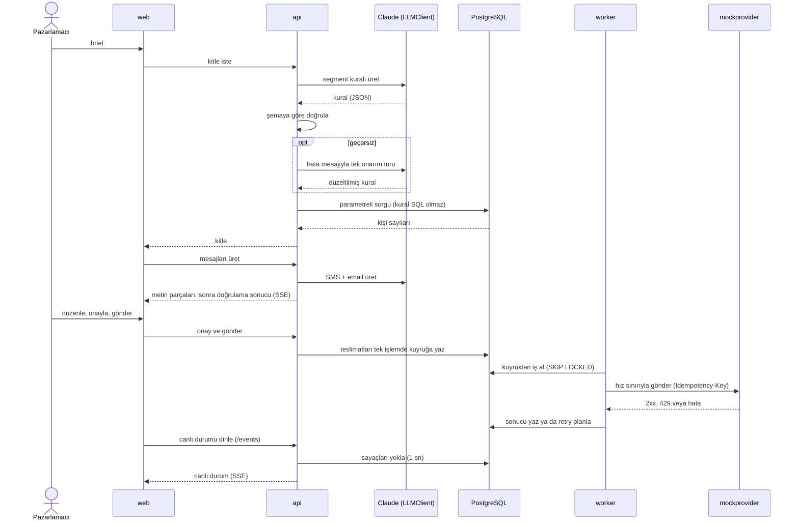
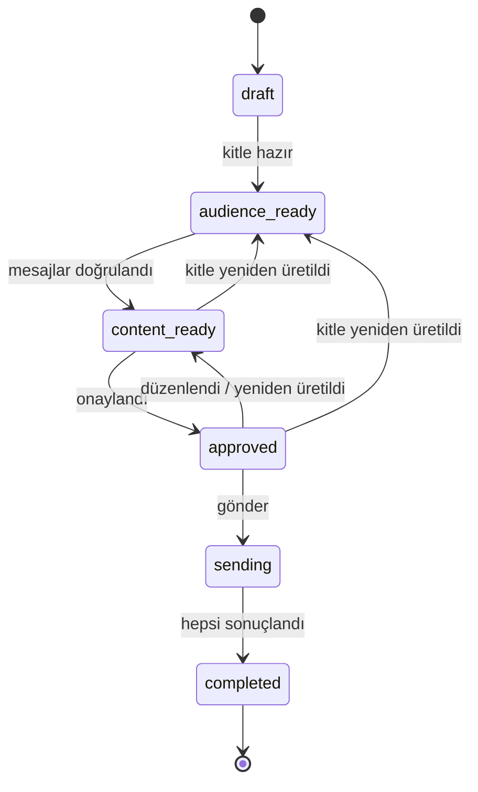
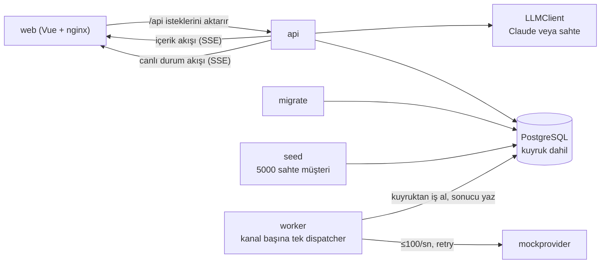

# Smart Campaign Composer

Pazarlamacı ne istediğini doğal dille yazar. Yapay zeka (Claude) hedef kitleyi ve SMS ile email metinlerini önerir, son kararı insan verir. Onaylanan mesajlar bir kuyruktan geçerek gönderilir ve gönderim canlı izlenir.

> "Son 30 günde sepetine ürün ekleyip alışveriş yapmayan İstanbul'daki kullanıcılara %30 indirim hatırlatması gönder. Samimi ama kısa olsun."

Ürün, kampanya hazırlayan pazarlamacılar içindir. Bilerek yapmadıkları: gerçek kimseye mesaj göndermez (alıcılar seed edilmiş sahte kullanıcılardır, gönderim kendi yazdığımız mock provider'adır) ve kimlik doğrulaması yoktur (yerel demo).

## Bir kampanya nasıl ilerler

1. **Brief.** Pazarlamacı isteğini yukarıdaki gibi düz cümleyle yazar.
2. **Kitle.** Claude brief'i bir segment kuralına çevirir (şehir, son 30 gün, sepet gibi alanlar). Arayüz kaç kişinin eşleştiğini, kaçına SMS ve email ile ulaşılabildiğini gösterir. İnsan kitleyi kontrol eder, gerekirse yeniden üretir.
3. **Mesajlar.** Claude SMS ve email metnini yazar; metin ekrana akarak gelir. Sistem uzunluk sınırlarını (SMS 160, email konusu 80, email gövdesi 5000 karakter; brief en çok 2000) değişkenler kitledeki en uzun değerle doldurulmuş hâliyle denetler. Yalnızca `{{first_name}}`, `{{last_name}}` ve `{{city}}` kabul edilir, bilinmeyen değişken reddedilir; boş ad yerine "Değerli müşterimiz" yazılır.
4. **Onay.** İnsan metni önizler, düzenler ve onaylar. Onaydan sonra metni değiştirirse onay düşer, yeniden onaylanır.
5. **Gönderim ve izleme.** Mesajlar kuyruğa girer, mock provider'a hız sınırıyla gider; panel gönderilen, bekleyen ve başarısız sayılarını canlı gösterir.

Yapay zekanın çıktısı her adımda denetlenir. Geçersizse hata mesajıyla bir kez daha denenir, yine geçersizse kullanıcıya anlaşılır bir hata gösterilir:



Mesaj üretimi de aynı doğrulama ve tek onarım turunu kullanır. Kampanya şu durumlardan geçer; kampanya düzeyinde hata durumu yoktur, tek tek mesaj hataları sayılarda görünür:



## Parçalar ve neden böyle

Tüm parçalar çalışır durumdadır (P5 sonu).



Tasarım fikirleri (gerekçeler ve alternatifler: [`DECISIONS.md`](DECISIONS.md)):

- **Claude serbest metin değil, yapılandırılmış JSON döndürür.** Serbest metni ayrıştırmak kırılgandır. JSON'u şemaya göre doğrulayabilir, hatalıysa modele nedenini söyleyip düzelttirebiliriz.
- **Yapay zekanın çıktısı asla SQL olmaz.** Segment kuralı kapalı bir dildir: izinli alanlar, operatörler, değer tipleri. Backend kuralı doğrular ve kendi koduyla parametreli sorguya çevirir. Böylece model ne yazarsa yazsın veritabanına yetkisiz sorgu gitmez.
- **Kuyruk PostgreSQL'dedir.** Gönderilecek her mesaj bir satırdır; durumu, tekrar denemesi ve "aynı kişiye aynı mesaj iki kez gitmez" kuralı (kampanya, kanal, alıcı tekil) o satırda tutulur. Bu ölçekte ayrı bir kuyruk servisi gereksiz karmaşıklık olurdu.
- **Retry kuralları bizim tasarımımızdır (D6).** En çok 5 deneme (ilk dahil); 5xx, 408 ve zaman aşımında üstel bekleme (1 sn'den 60 sn'ye, jitter'lı); diğer 4xx tekrar denenmez. 429 `Retry-After`'e uyar ve ayrı bir bütçeden sayılır (en çok 20 kez veya 10 dk). Biten deneme `failed` teslimat olur ve takip ekranında görünür.
- **İzni sistem uygular, model değil.** SMS ve email izinleri ayrıdır. İzni olmayan kişi kitle sorgusunda elenir; bunu modelin akıl yürütmesine bırakmak güvence vermez.
- **Sahte LLM ve mock provider vardır.** Anahtar yoksa sahte LLM devreye girer; mock provider rastgele hata, gecikme ve 429 üretir. Böylece testler ve demo anahtarsız çalışır, retry mantığı gerçekten denenir.

## Durum

Faz kapsamları: [`docs/PLAN.md`](docs/PLAN.md). Durum yalnızca koddan, git geçmişinden ve PR'lardan doğrulananlara göre yazıldı.

| Faz | Durum | Kapsam |
|---|---|---|
| P0 Kurulum | ✅ bitti | Repo, hook'lar, CI, plan |
| P1 Sözleşmeler | ✅ bitti | Gereksinimler, OpenAPI, şemalar, arayüz ve Go sözleşmeleri |
| P2 Seed + altyapı | ✅ bitti | Seed, migration'lar, compose, LLM fabrikası ve sahte LLM, mock provider, `make test` |
| P3 Kitle | ✅ bitti | Segment kuralı, kişi sayıları, brief ve kitle ekranları, API'nin sözleşmeden sapmaması için koruma |
| P4 İçerik + onay | ✅ bitti | SMS/email üretimi (SSE akışı), karakter limitleri, kişiselleştirme, düzenleme (sürümlü), onay, önizleme; içerik ve onay ekranları |
| P5 Gönderim + takip | ✅ bitti | Gönderim API'si, kuyruk ve worker (kanal başına tek dispatcher, hız sınırı, retry), canlı durum akışı (SSE) ve takip ekranı, veritabanında üretim kirası, "Claude düşünüyor" bekleme durumu, tüm ekranlarda responsive düzen |
| P6 Sertleştirme + teslim | ⬜ başlamadı | Uçtan uca test, güvenlik taraması, son README ve DECISIONS |
| Bonus: CI | ✅ var | GitHub Actions, `main` için zorunlu `ci-ok` kontrolü: lint, `make test`, gitleaks, govulncheck (yalnız doküman değişen PR'da build/test atlanır, D51) |
| Bonus: diğerleri | ⬜ başlamadı | Zamanlanmış gönderim, A/B varyantları, dile göre içerik |

## Çalıştırma

Gereken yalnızca Docker (Compose v2.24 veya üstü; isteğe bağlı `.env` için) ve make.

```sh
cp .env.example .env   # isteğe bağlı; dosya yoksa da çalışır
docker compose up      # veritabanı, migration, seed, api, worker, mock provider, web arayüzü
make test              # tüm testler (Go + Vitest) konteynerde, API key'siz
make help              # diğer komutlar
```

`.env` dosyasına `ANTHROPIC_API_KEY` yazarsanız sistem gerçek Claude'u kullanır (varsayılan model `claude-opus-5-5`, `ANTHROPIC_MODEL` ile değişir), boş bırakırsanız sahte LLM çalışır. `LLM_PROVIDER=mock` anahtar olsa da sahte LLM'i, `real` anahtar yoksa açılışta hatayı seçer. Örnek: [`.env.example`](.env.example). Sahte LLM brief'i okumaz: hangi brief yazılırsa yazılsın aynı örnek kuralı ve metni döndürür.

Koda katkı verecekseniz klonladıktan sonra ilk iş `make hooks` (lefthook ve gitleaks gerekir; araç listesi [`CLAUDE.md`](CLAUDE.md) "Komutlar").

Bugün denenebilecek olan: `docker compose up` bitince tarayıcıda <http://127.0.0.1:8081> adresini açın (bu port başka bir programda doluysa `.env` dosyasına `WEB_PORT=8082` gibi boş bir port yazın; API için `API_PORT` aynı şekilde çalışır; hangi portun açıldığını `docker compose ps` gösterir) ve örnek brief'i yazın ("Son 30 günde sepetine ürün ekleyip alışveriş yapmayan İstanbul'daki kullanıcılara %30 indirim hatırlatması gönder"); sistem segment kuralını ve kanal başına kaç kişiye ulaşılacağını gösterir. Ardından aynı kampanya için SMS ve email içeriğinin akarak üretildiğini görür, metni düzenler ve onaylarsınız. "Gönder" ile teslimatlar kuyruğa yazılır; worker bunları kanal başına hız sınırıyla mock provider'a gönderir ve takip ekranı gönderilen, bekleyen ve başarısız sayılarını sayfa yenilenmeden gösterir. Kampanya tamamlanınca başarısız teslimat varsa "Başarısızları gör" bağlantısı listeyi açar. Ekranlar telefon (375 px), tablet (768 px) ve masaüstü (1280 px) genişliklerinde kullanılabilir.

Takip uç noktaları API portundadır (varsayılan <http://127.0.0.1:8080>), web portunda değil: `/healthz` (süreç ayakta), `/readyz` (veritabanı erişilebilir) ve `/metrics` (Prometheus; teslimat sayaçları veritabanından). Worker aynı üçünü iç ağda 8081'de sunar, host'a açılmaz; mock provider yalnız `/healthz` sunar ([`docs/contracts/metrics.md`](docs/contracts/metrics.md)). API başvurusu: [`docs/contracts/openapi.yaml`](docs/contracts/openapi.yaml).

Seed ilk açılışta "bugüne" göre üretilir ve sonraki açılışlarda dokunulmaz (`--if-empty`, D24); günler geçtikçe "son 30 gün" sayıları azalır. Veriyi bugüne göre yeniden üretmek kampanya ve teslimatları siler: `docker compose run --rm seed seed --ref-time=now --reset --manifest=/tmp/manifest.json`.

## Nereden okunur

- [`DECISIONS.md`](DECISIONS.md): önemli kararlar, gerekçeleri, bilinen sınırlar
- [`docs/PLAN.md`](docs/PLAN.md): fazlar, git akışı, roller
- [`docs/requirements.md`](docs/requirements.md): gereksinim kataloğu
- [`docs/contracts/`](docs/contracts/README.md): API, veri ve LLM araç sözleşmeleri
- [`DESIGN.md`](DESIGN.md): görsel sistem ve ekranlar
- [`ai-sessions/INDEX.md`](ai-sessions/INDEX.md): temizlenmiş Claude session kayıtları
- [`CLAUDE.md`](CLAUDE.md): proje kuralları ve ajan talimatları

## Güvenlik ve sınırlar

- Claude anahtarı yalnızca yerel `.env` dosyasında durur; git'e girmez, hook'lar ve CI sızıntıyı tarar.
- Yapay zeka SQL yazmaz; kural doğrulanır ve parametreli sorguya kod tarafından çevrilir.
- Kanal izni olmayan kişiye o kanaldan mesaj gitmez.
- API ile dokümanı CI aynı tutar: OpenAPI sözleşmedir; API E2E testlerinin yaptığı her istek ve aldığı her cevap ona göre doğrulanır, router rotaları spec yollarıyla birebir eşleşmek zorundadır (D30).
- Kimlik doğrulama yoktur; sistem yerel demo olarak yalnızca `127.0.0.1`'e açılır.
- Gönderim kanal başına saniyede en çok 100 istekle sınırlıdır; aynı kişiye aynı mesaj iki kez gitmez (veritabanı tekilliği + sağlayıcıya `Idempotency-Key`).
- Var: API düzeyinde uçtan uca testler (`test/e2e`, key'siz tam kampanya brief → `completed`), CI'da gitleaks ve govulncheck. Henüz yok (P6): tarayıcıdan uçtan uca test, CodeQL ve imaj taraması (D27).
- Yapılmayan bonuslar: zamanlanmış gönderim, A/B varyantları, dile göre içerik.

## Bilinen sınırlar

- Üretim kilidi kampanya satırında süreli bir kiradır (en çok 120 sn); bitişi API süreçlerinin saatine dayanır, süreçler arası saat kayması bitişi o kadar kaydırır ([`DECISIONS.md`](DECISIONS.md) D52).
- Kanal kilidi her partinin başında denetlenir; kilit kaybolursa eski gönderici en çok bir partiyi (varsayılan 50 istek) bitirir, o kısa sürede kanalda bir partilik fazla gönderim başlangıcı olabilir. Aynı mesaj yine iki kez gitmez (D53).
- Canlı durum akışı art arda 5 başarısız okumada (≈5 sn) kapanır; ekran `stale` olur ve yeniden bağlanır. Daha kısa kesintilerde sayaçlar birkaç saniye eski kalabilir (D54).
- Elle yapılan denemede gözlenen gönderim hızı kanal başına yaklaşık 50/sn'dir, 100 sınırının altında; otomatik bir hız ölçümü yoktur.
- Gönderim anı uzunluk denetimi (`CheckRendered`) bir alıcı için iki kanalın metnini birlikte denetler: SMS metni kişiselleştirmeyle 160'ı aşarsa o kişinin email teslimatı da `content_too_long` ile başarısız olur (veya tersi). Kanal bazlı denetim sözleşme değişikliği gerektirir.
- Dokunmatik boyutlar (44 px) ekran genişliğine göre (`max-lg:`, <1024 px) uygulanır, `pointer: coarse`'a göre değil; dar pencereli masaüstü de büyük hedef görür.
- İçerik ekranının eylem şeridi mobilde yapışkan değildir (sayfanın sonunda kalır); Onay ekranının `ApprovalBar`'ı yapışkandır.
- Swagger UI gibi etkileşimli API dokümanı yoktur (sahip kararıyla kaldırıldı, D36). API başvurusu: [`docs/contracts/openapi.yaml`](docs/contracts/openapi.yaml).
- Otomatik testler yalnızca `docs/requirements.md`'den türetilir (D50); yalnız sözleşmede yazan birçok davranış testsizdir.
- Gerçek Claude istemcisinin otomatik testi yoktur; şehir yazımı ve SMS uzunluğu gibi davranışlar elle doğrulanmalıdır.
- CI artık `web-image`, `compose-ports` ve `actionlint` kontrollerini çalıştırmaz (D27, D51).
- Brief kampanya oluşturulduktan sonra değiştirilemez; "Brief'i düzenle" yeni kampanya başlatır.
- Email gövdesinin 5000 sınırı onay anında yeniden denetlenmez, yalnız doğrulamada denetlenir (D46).
- SMS uzunluğu karakter (Unicode rune) olarak sayılır; gerçek SMS segmenti GSM-7/UCS-2'ye göre değişir, Türkçe karakterli mesajda 70'e düşer (D10).
- Tekilleştirme müşteri bazındadır: aynı telefonu veya e-postayı paylaşan iki müşteri kaydı iki teslimat alır (D3).
- Kitle sorgusu eşleşen satırları Go'ya çeker; seed ölçeğinde (5000) yeterli, milyonlarca kayıtta değil. Kuyruk da bu ölçek için seçildi; yol `Queue` arayüzü (D1).
