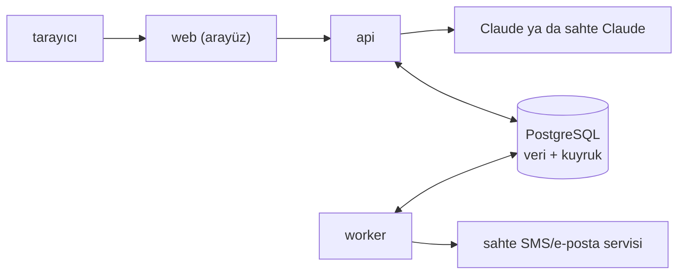

# Smart Campaign Composer

Smart Campaign Composer, pazarlama ekiplerinin kampanyalarını doğal dille tanımlamasını sağlar. Pazarlamacı ne istediğini yazar; Claude hedef kitleyi ve SMS ile e-posta metinlerini önerir. Son kararı insan verir: onaylanan mesajlar sahte bir gönderim servisine iletilir ve gönderim ekranda canlı olarak izlenir.

**Hiçbir gerçek kişiye mesaj gönderilmez.** Alıcılar sahte kullanıcılardır; gönderim de sahte (mock) bir servise yapılır.

## Durum

| Kapsam | Durum |
|---|---|
| Çekirdek akış: kitle → mesaj → onay → gönderim → izleme | ✅ |
| Bonuslar: zamanlanmış gönderim, kullanıcının diline göre içerik, A/B varyantları, CI | ✅ Dördü de |

Bunlara ek olarak, planlanan ve gönderilen kampanyaları listeleyen bir panel ile yeniden tasarlanmış bir takip ekranı bulunur.

## Çalıştırma

Gereksinimler: Docker (çalışır durumda olmalıdır) ve `make`. API anahtarı gerekmez.

**1. Depoyu klonlayın ve klasöre geçin.** Sonraki tüm komutlar bu klasörde çalıştırılır.

```sh
git clone https://github.com/gulcint/smart-campaign-composer.git
cd smart-campaign-composer
```

**2. (İsteğe bağlı) Gerçek Claude için API anahtarını ekleyin.**

```sh
cp .env.example .env   # ardından ANTHROPIC_API_KEY satırını doldurun
```

Anahtar tanımlı değilse sistem sahte Claude ile çalışır. Sahte Claude brief'i yorumlamaz; her seferinde aynı örnek kitleyi ve metni döndürür.

**3. Sistemi başlatın.** İlk açılışta imajlar derlendiği için bu adım birkaç dakika sürebilir. Veritabanı kurulur ve 5000 sahte kullanıcı yüklenir.

```sh
docker compose up
```

**4. Arayüzü açın.** Arayüz <http://127.0.0.1:8081> adresindedir. Sistemin hazır olup olmadığını <http://127.0.0.1:8080/readyz> gösterir: `"status":"ready"` yanıtı sistemin hazır olduğunu belirtir; `503` yanıtı alırsanız birkaç saniye bekleyin.

**5. Testleri çalıştırın.** Testler kendi konteynerlerinde, ayrı bir veritabanıyla ve API anahtarı olmadan çalışır. Arayüz açıkken de çalıştırılabilir.

```sh
make test
```

**Durdurma**

```sh
docker compose down      # sistemi durdurur, veriler korunur
docker compose down -v   # verileri de siler; sonraki açılışta her şey baştan kurulur
```

**Sık karşılaşılan sorunlar**

- `port is already allocated`: Port başka bir program tarafından kullanılıyor. Farklı portlar belirtin: `API_PORT=18080 WEB_PORT=18081 docker compose up`. Bu durumda yukarıdaki adresler de yeni portlarla değişir.
- Docker'a bağlanılamıyor: Docker çalışmıyor. Docker Desktop'ı başlatın.
- `no configuration file provided`: Komut proje klasörünün dışında çalıştırılmış. `cd smart-campaign-composer` ile klasöre geçin.

## Neler denenebilir

Brief ekranındaki **"Örnek brief'i kullan"** düğmesi metin alanını şu brief ile doldurur:

> "Son 60 günde alışveriş yapmayan müşterilere %15 indirimle geri dönmeleri için mesaj gönder. Sıcak bir dil kullan."

Case dokümanındaki İstanbul örneği de aynı şekilde çalışır.

1. **Kitle:** Claude, brief'ten bir kitle kuralı çıkarır. Ekran, kurala kaç kişinin uyduğunu ve bunlardan kaçının SMS veya e-posta alabileceğini gösterir.
2. **Mesajlar:** SMS ve e-posta metinleri ekrana akarak yazılır. "A/B testi" seçeneğini açarak iki farklı mesaj varyantı üretebilirsiniz. Kitlede İngilizce konuşan kullanıcılar varsa İngilizce metin de üretilir.
3. **Onay:** Metni önizleyin, gerekirse düzenleyin ve onaylayın.
4. **Gönderim:** Kampanyayı hemen gönderin ya da ileri bir tarih ve saate planlayın (Türkiye saati, UTC+3).
5. **Takip:** Gönderim canlı olarak izlenir ve "Kampanya tamamlandı" mesajıyla sona erer. Birkaç mesajın başarısız olması normaldir; sahte servis bilerek hata döndürür.
6. **Panel:** Brief ekranının altında planlanan ve gönderilen kampanyaların listesi yer alır.


## Nasıl çalışır



Arayüz Vue, backend Go ile yazılmıştır. Onaylanan mesajlar veritabanındaki bir kuyruğa yazılır; `worker` servisi bu mesajları sırayla sahte gönderim servisine iletir.

Temel güvenceler:

- **Claude'un yanıtı doğrulanır.** Claude yapılandırılmış JSON döndürür ve backend bu yanıtı doğrular. Yanıt geçersizse bir kez daha denenir; yine geçersizse kullanıcıya anlaşılır bir hata mesajı gösterilir.
- **Claude'un ürettiği içerik veritabanında komut olarak çalıştırılmaz.** Kitle kuralı yalnızca izin verilen alanlardan oluşur; sorguyu backend kendisi kurar (D8).
- **İzin yoksa mesaj gönderilmez.** SMS ve e-posta izinleri ayrı ayrı tutulur ve sistem tarafından denetlenir.
- **Uzunluk sınırı:** SMS en fazla 160, e-posta konusu en fazla 80 karakterdir. Sınır, `{{first_name}}` gibi değişkenler doldurulduktan sonraki metne göre ölçülür.
- **Hız sınırı:** Her kanal için saniyede en fazla 100 mesaj gönderilir.
- **Aynı kişiye aynı mesaj iki kez gönderilmez.** Hata alan bir mesaj, ilk deneme dahil en fazla 5 kez ve artan aralıklarla yeniden denenir; ardından başarısız sayılır (D6).
- **API anahtarı gerekmez.** Testler ve `docker compose up` sahte Claude ile çalışır.

Kararların gerekçeleri için [`DECISIONS.md`](DECISIONS.md) dosyasına bakabilirsiniz.

Son tam test çalıştırmasında API anahtarı olmadan `make test` başarıyla tamamlandı (Go ve web testleri).
Temiz kurulumda sistem yaklaşık 15 saniyede hazır oldu; İstanbul brief'iyle 720 mesaj yaklaşık 23 saniyede işlendi, mükerrer ve izinsiz gönderim sayısı 0 oldu.

## Bilinen sınırlamalar

- **A/B testinde kazanan varyant ölçülmez.** Sahte servis açılma ve tıklama verisi üretmez; yalnızca varyant başına gönderim sonuçları görüntülenir.
- **Gerçek Claude'un davranışı otomatik olarak test edilmez.** Brief'in doğru yorumlanması ve metin kalitesi sahte Claude ile ölçülemez.
- **Verilerde karşılığı olmayan koşullar atlanabilir.** Örneğin "25 yaş altı" koşulunun karşılığı yoktur, çünkü verilerde yaş bilgisi bulunmaz; Claude bu koşulu sessizce atlayabilir. Buna karşı güvence, kitle kartının insan tarafından kontrol edilmesidir.
- **Bazı senaryolar elle doğrulanmadı.** A/B varyantları ile İngilizce metnin birlikte istendiği durumda gerçek API'nin yanıtı henüz elle denenmedi.
- **Saat dilimi olarak yalnızca Türkiye saati (UTC+3) desteklenir.**
- **Desteklenen diller yalnızca Türkçe ve İngilizcedir.** Sistem İngilizce metnin kalitesini ölçmez; buradaki güvence insan onayıdır.
- **Ölçek demo amaçlıdır.** Sistem 5000 sahte kullanıcıyla sorunsuz çalışır; milyonlarca kullanıcıya göre tasarlanmamıştır.

## Daha fazla bilgi

- [`DECISIONS.md`](DECISIONS.md): Kararlar, gerekçeleri ve sınırlamaların tam listesi
- [`docs/PLAN.md`](docs/PLAN.md): Geliştirme fazları ve süreci (ayrı rollere sahip ajanlar)
- [`docs/requirements.md`](docs/requirements.md): Gereksinimler ve kabul ölçütleri
- [`docs/contracts/openapi.yaml`](docs/contracts/openapi.yaml): API uç noktaları
- [`docs/contracts/db-schema.md`](docs/contracts/db-schema.md): Veri modeli
- [`DESIGN.md`](DESIGN.md): Arayüz tasarımı
- [`ai-sessions/INDEX.md`](ai-sessions/INDEX.md): Claude oturum kayıtları
