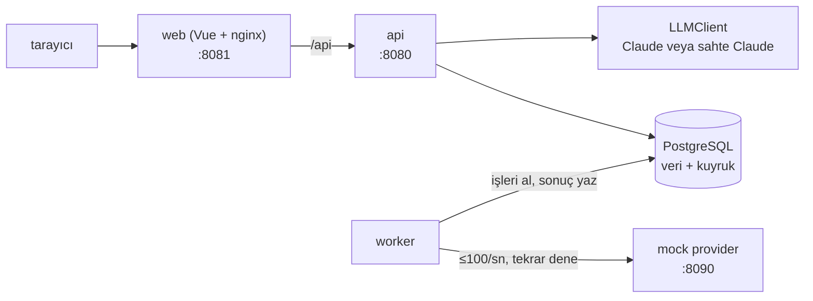

# Smart Campaign Composer

Pazarlamacı ne istediğini doğal dille yazar. Claude hedef kitleyi ve SMS ile email metnini önerir. Son kararı insan verir. Onaylanan mesajlar kuyruktan sahte (mock) bir servise gider. Gönderim ekranda canlı izlenir.

**Gerçek kimseye mesaj gitmez.** Alıcılar sahte kullanıcılardır.

Teknolojiler: Vue 3 (arayüz), Go (backend), Claude API, PostgreSQL (veri ve kuyruk).

## Durum

| | |
|---|---|
| Çekirdek akış (kitle → mesaj → onay → gönderim → izleme) | ✅ Tamam |
| API key olmadan çalışma (sahte Claude) | ✅ Tamam |
| Bonus: zamanlanmış gönderim (D62) | ✅ Tamam |
| Bonus: kullanıcının diline göre içerik (D63) | ✅ Tamam |
| Bonus: CI pipeline | ✅ Tamam |
| Bonus: A/B varyantları | ⬜ Planlandı, devam ediyor (P9, [`docs/PLAN.md`](docs/PLAN.md) §11) |

## Çalıştırma

**Gerekenler:** Docker ve Docker Compose v2 (Docker açık olmalı), `make`. API key gerekmez.

**1. Klonla ve klasöre gir**

```sh
git clone https://github.com/gulcint/smart-campaign-composer.git
cd smart-campaign-composer
```

Komutları bu klasörde çalıştır. Başka klasörde `docker compose up` `no configuration file provided` hatası verir.

**2. (İsteğe bağlı) `.env` hazırla**

```sh
cp .env.example .env
```

- `ANTHROPIC_API_KEY`: boşsa sahte Claude çalışır. Sahte Claude brief'i okumaz, hep aynı örnek kitleyi ve metni döner.
- `LLM_PROVIDER`: `auto` (varsayılan) key varsa Claude'u, yoksa sahteyi seçer. `mock` her zaman sahteyi seçer. `real` key yoksa başlamaz.

`.env` git'e girmez. Değiştirince `docker compose up` komutunu yeniden çalıştır.

**3. Başlat**

```sh
docker compose up
```

İlk açılışta imajlar derlenir, biraz sürer. Servisler:

| Servis | Ne yapar |
|---|---|
| `db` | PostgreSQL 16 |
| `migrate` | Tabloları kurar, çıkar |
| `seed` | 5000 sahte kullanıcı yükler, çıkar (sonraki açılışlarda veriye dokunmaz) |
| `api`, `worker`, `mockprovider` | API (8080), gönderim işçisi ve sahte SMS/email servisi |
| `web` | Arayüz (8081); `/api` isteklerini API'ye yönlendirir |

Ctrl+C durdurur. Konteynerler kalır, aynı komutla devam eder.

**4. Hazır mı kontrol et**

- Arayüz: <http://127.0.0.1:8081>
- Sağlık: <http://127.0.0.1:8080/readyz>. `200` ve `"status":"ready"` ise hazır. `503` ise birkaç saniye bekle.
- `docker compose ps -a`: `migrate` ve `seed` `exited (0)`, diğerleri `running` olmalı.

**`port is already allocated` alırsan:** port başka programda. `API_PORT=18080 docker compose up` ile başlat; sağlık adresi <http://127.0.0.1:18080/readyz> olur. Arayüz portu da doluysa `WEB_PORT=18081` ekle. İkisi `.env` içine de yazılabilir.

**5. Testler**

```sh
make test
```

Testler kendi konteynerlerinde, ayrı geçici veritabanıyla çalışır (Compose projesi `scc-test`). Port açmaz, geliştirme verisine dokunmaz. Arayüz açıkken de çalışır.

**Durdurma**

```sh
docker compose down      # konteynerleri kaldırır, veri kalır
docker compose down -v   # veritabanını da siler; sonraki up her şeyi baştan kurar
```

Kod geliştirecekseniz önce `make hooks`. Diğer komutlar: `make help`.

### Sorun giderme

| Belirti | Neden ve çözüm |
|---|---|
| `no configuration file provided` | Klasör dışındasın. `cd smart-campaign-composer`. |
| `port is already allocated` | Port dolu. Yukarıdaki port notuna bak. |
| Docker bağlanamıyor | Docker kapalı. Docker Desktop'ı ya da servisi başlat. |
| `readyz` hep `503` | `docker compose ps -a` ve `docker compose logs migrate seed` ile hatayı bul. |
| Sahte Claude çalışıyor | `.env` yok ya da key boş. `docker compose logs api` içinde `"llm_provider":"mock"` görünür. |
| Veriyi sıfırlamak | `docker compose down -v`, sonra `docker compose up`. |

## Ne denenir

Arayüzde bu brief'i yapıştır:

> "Son 30 günde sepetine ürün ekleyip alışveriş yapmayan İstanbul'daki kullanıcılara %30 indirim hatırlatması gönder. Samimi ama kısa olsun."

1. **Kitle:** Claude bir segment kuralı çıkarır. Ekran eşleşen kişi sayısını ve SMS/email alabilecek kişi sayısını gösterir.
2. **Mesajlar:** SMS ve email metni ekrana akarak gelir.
3. **Onay:** Önizle, düzenle, onayla. Onaydan sonra düzenleme onayı düşürür.
4. **Gönderim:** Hemen gönder ya da ileri tarihe planla.
5. **Takip:** Gönderilen, bekleyen ve başarısız sayılar canlı akar. Ekran "Kampanya tamamlandı" ile biter. Birkaç başarısız mesaj normaldir; mock servis bilerek hata verir.


Kampanya durumları: `draft` → `audience_ready` → `content_ready` → `approved` → (`scheduled`) → `sending` → `completed`. Kitle ya da metin değişirse kampanya geri döner ve yeniden onay ister.

**Ölçülen sonuç (2026-10-30, temiz klon, key yok):** sistem ~15 sn'de hazır. Örnek brief API üzerinden uçtan uca çalıştı:

- 720 teslimat (351 SMS, 369 email), ~23 sn'de bitti.
- 0 tekrar gönderim, izinsiz kişiye 0 gönderim.
- Kanal başına en çok 46 mesaj/sn (limit 100).
- Mock servis 429 ve 5xx döndü, bunlar tekrar denendi. 11 teslimat `max_attempts_exceeded` ile başarısız oldu.
- `make test` geçti: tüm Go paketleri ve 223 web testi.

## Case isterleri nasıl karşılandı

Gerekçeler [`DECISIONS.md`](DECISIONS.md) içinde, D numaralarıyla.

| İster | Nasıl |
|---|---|
| LLM çıktısı SQL olmaz | Claude yalnız izinli alan, operatör ve tiplerden kural üretir. Backend doğrular, parametreli sorguyu kendisi kurar (D8). |
| Kanal izni | SMS ve email izni ayrı. Kontrolü model değil sistem yapar (D9). |
| SMS ≤ 160, konu ≤ 80 | Değişkenler kitledeki en uzun değerle doldurulduktan sonra ölçülür (D10). |
| Kişiselleştirme | `{{first_name}}`, `{{last_name}}`, `{{city}}`. Bilinmeyen değişken reddedilir. |
| Asenkron kuyruk | PostgreSQL'deki `deliveries` tablosu kuyruğun kendisidir (D1, D2). |
| Kanal başına ≤ 100/sn | Her kanal için tek gönderici ve token bucket (D5). Sahte saatli test: `test/delivery/dispatcher_test.go`. |
| Aynı kişiye iki kez gitmez | Kampanya + kanal + alıcı tekil. Mock servise her denemede aynı `Idempotency-Key` gider (D3). |
| Retry | En fazla 5 deneme. 5xx ve zaman aşımında artan bekleme (1–60 sn). 429'da `Retry-After`'a uyulur, ayrı bütçeyle. Diğer 4xx denenmez. Hakkı biten `failed` olur (D6). |
| Takip | Canlı durum SSE ile akar. `/healthz`, `/readyz`, `/metrics` API portunda. API: [`docs/contracts/openapi.yaml`](docs/contracts/openapi.yaml). |
| Yapılandırılmış JSON | Claude tool use ile JSON döner, backend tekrar doğrular. Geçersizse hatalar modele gönderilip bir kez daha denenir. Yine geçersizse kullanıcıya anlaşılır hata gösterilir (D7, D23). |
| Key'siz test | Claude erişimi `LLMClient` arayüzünün arkasında. Testler ve `docker compose up` sahte Claude ile çalışır (D11). |
| Seed | 5000 kişi: ad, email, telefon, şehir, dil, sadakat seviyesi, kanal izinleri, sepet ve satın alma geçmişi ([`docs/contracts/seed.md`](docs/contracts/seed.md)). |
| Mock provider | Ayrı servis. Rastgele hata, gecikme ve 429 döner. Demoda %40 hata ve %10 429 ayarlı. |

**Bonuslar**

- **Zamanlanmış gönderim (D62):** onaylı kampanya 1 dakika ile 30 gün sonrasına planlanır. Plan değiştirilir, iptal edilir ya da hemen gönderilir.
- **Dile göre içerik (D63):** kitlede İngilizce konuşan varsa Claude İngilizce sürümü de yazar. Ekranlarda TR/EN sekmeleri var. Her alıcı kendi dilindeki metni alır; İngilizce yoksa Türkçe gider.
- **CI (GitHub Actions):** `main`'e girmek için `ci-ok` yeşil olmalı (lint, `make test`, gitleaks, govulncheck, API sözleşmesi).

## Mimari



- **api:** kampanya, kitle, içerik, onay ve gönderim uçları. İçerik ve canlı durum SSE ile akar.
- **worker:** kuyruğu hız sınırı ve tekrar denemeyle işler. Zamanı gelen planlı kampanyaları başlatır.
- **web:** Vue arayüzü ([`DESIGN.md`](DESIGN.md)).
- **migrate / seed:** veritabanını kurar, sahte kullanıcıları yükler.

## Bilinen sınırlar

- **A/B varyantları bitmedi.** Planlandı, P9 olarak devam ediyor ([`docs/PLAN.md`](docs/PLAN.md) §11); henüz `main`'de değil.
- **Dil:** yalnız `tr` ve `en`. İngilizce metnin kalitesini sistem ölçmez; güvence insan onayıdır (D63).
- **Ölçek:** kitle Go belleğine yüklenir. 5000 kişi için yeterli, milyonlar için değil (D1).
- **Hız:** 100/sn sınırı sahte saatli testle doğrulanır. Gerçek zamanlı yük testi yok.
- **SMS uzunluğu** karakterle sayılır. Türkçe harfli gerçek bir SMS parçası 70 karakterdir (D10).
- **Uzunluk kontrolü** bir kişinin SMS ve emailini birlikte değerlendirir. Biri uzarsa diğeri de `content_too_long` ile düşer.
- **Brief** kampanya açıldıktan sonra değişmez. "Brief'i düzenle" yeni kampanya başlatır.
- **Aynı telefonu/emaili paylaşan iki müşteri** ayrı kişi sayılır (D3).
- **Planlı gönderim:** worker kapalıyken zamanı geçen plan, worker açılınca gönderilir. Arayüz yalnız İstanbul saatiyle plan alır (D62).
- **Canlı akış** kesilirse ekran `stale` gösterir ve yeniden bağlanır. Sayaçlar birkaç saniye geride olabilir (D54).
- **Testler** yalnız `docs/requirements.md`'den yazıldı (D50). Gerçek Claude istemcisinin otomatik testi yok.

Tam liste: [`DECISIONS.md`](DECISIONS.md).

## Teslim edilenler

| İstenen | Durum |
|---|---|
| GitHub repo | ✅ `gulcint/smart-campaign-composer` |
| `docker compose up` (seed ve mock dahil) | ✅ |
| `make test` (key'siz) | ✅ |
| `README.md` | ✅ bu dosya |
| `DECISIONS.md` | ✅ |
| `ai-sessions/` | ✅ temizlenmiş ([`ai-sessions/INDEX.md`](ai-sessions/INDEX.md)) |

## Nasıl geliştirildi

Proje Claude Code ile, ayrı rollere sahip ajanlarla geliştirildi ([`docs/PLAN.md`](docs/PLAN.md)). Orkestratör işi böler. Test yazarı yalnız [`docs/requirements.md`](docs/requirements.md)'yi okur, kodu görmez. Kodu yazan, gözden geçiren ve doğrulayan ayrı rollerdir. `main`'e yalnız CI'ı yeşil PR girer.

## Nerede ne var

| Konu | Yer |
|---|---|
| LLM entegrasyonu | `internal/llm/`, `docs/contracts/schemas/llm/` |
| Kararlar ve sözleşmeler | [`DECISIONS.md`](DECISIONS.md), [`docs/contracts/`](docs/contracts/README.md) |
| Gönderim | `internal/delivery/`, `internal/postgres/`, `cmd/worker/` |
| Arayüz | `web/src/`, [`DESIGN.md`](DESIGN.md) |
| Testler | `test/`, `internal/**/*_test.go`, `web/tests/`, [`docs/requirements.md`](docs/requirements.md) |
| Plan ve fazlar | [`docs/PLAN.md`](docs/PLAN.md) |
| Proje kuralları | [`CLAUDE.md`](CLAUDE.md) |
