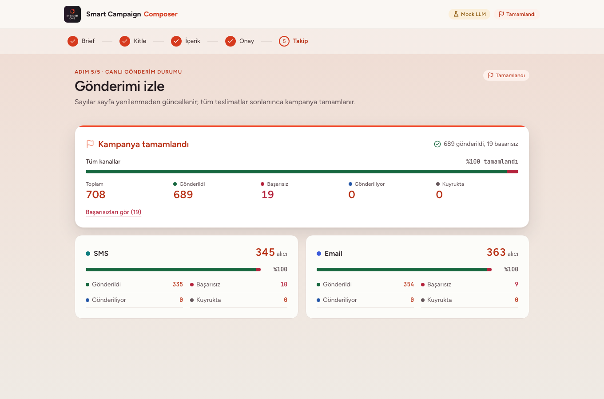
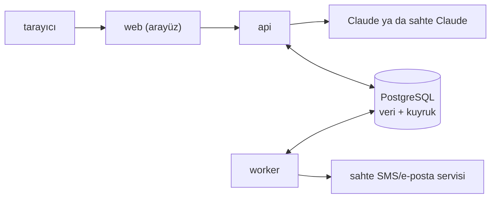

# Smart Campaign Composer

Smart Campaign Composer, pazarlama ekiplerinin kampanyalarını doğal dille tanımlamasını sağlar. Pazarlamacı ne istediğini yazar; Claude hedef kitleyi ve SMS ile e-posta metinlerini önerir. Son kararı insan verir: onaylanan mesajlar sahte bir gönderim servisine iletilir ve gönderim ekranda canlı olarak izlenir.

**Hiçbir gerçek kişiye mesaj gönderilmez.** Alıcılar sahte kullanıcılardır; gönderim de sahte (mock) bir servise yapılır.

## Case isterleri

Tablo, case dokümanının bölümlerini ve maddelerini izler. Parantez içindeki kodlar [`DECISIONS.md`](DECISIONS.md) dosyasındaki ilgili kararları gösterir.

| Bölüm | Case isteri | Nasıl karşılandı |
|---|---|---|
| Kullanıcı akışı | Kitle çıkarılır | Claude brief'ten bir segment kuralı üretir; arayüz eşleşen kişi sayısını ve kanal bazında ulaşılabilir kişi sayısını gösterir ✅ |
| | Mesajlar üretilir | SMS ve e-posta içeriği SSE ile ekrana akarak gelir ✅ |
| | İnsan onaylar | Pazarlamacı içeriği önizler, gerekirse düzenler ve onaylar; yalnızca onaylanan sürüm gönderilir ✅ |
| | Gönderilir | Mesajlar PostgreSQL üzerindeki kuyruk aracılığıyla sahte servise gönderilir (D1) ✅ |
| | Canlı izlenir | Takip ekranı gönderim durumunu canlı olarak gösterir ✅ |
| Fonksiyonel gereksinimler | Segment kuralı backend'de doğrulanır; LLM çıktısı doğrudan SQL olarak çalıştırılmaz | Kural yalnızca izin verilen alan ve operatörlerden oluşur; parametreli sorguyu backend kurar (D8) ✅ |
| | İzni olmayan kullanıcıya o kanaldan mesaj gönderilmez | SMS ve e-posta izinleri ayrı tutulur; denetimi model değil sistem yapar (D9) ✅ |
| | SMS en fazla 160, e-posta konusu en fazla 80 karakter | Sınırlar, değişkenler doldurulduktan sonraki metne göre ölçülür (D10) ✅ |
| | `{{first_name}}` gibi kişiselleştirme değişkenleri | Desteklenir; bilinmeyen değişkenler reddedilir ✅ |
| | Asenkron kuyruk, kanal başına saniyede en fazla 100 mesaj | Her kanal için tek dağıtıcı ve hız sınırlayıcı kullanılır (D5) ✅ |
| | Aynı kişiye aynı mesaj iki kez gitmez; yeniden deneme stratejisi | Veritabanı tekillik kısıtı ve `Idempotency-Key` (D3); ilk deneme dahil en fazla 5 deneme, artan aralıklar, 429'da `Retry-After` (D6) ✅ |
| | Canlı gönderim durumu, metrics ve health check uç noktaları | SSE ile canlı durum akışı, `/metrics`, `/healthz` ve `/readyz` ✅ |
| AI gereksinimleri | Doğrulama: yapılandırılmış JSON, backend'de kontrol | Claude araç kullanımıyla JSON döndürür ve backend bunu doğrular; geçersizse bir düzeltme denemesi yapılır, ardından anlaşılır bir hata gösterilir (D7) ✅ |
| | Test edilebilirlik: gerçek API anahtarı olmadan, sahte LLM ile | LLM bir arayüzün arkasındadır; anahtar yoksa sahte Claude devreye girer (D11) ✅ |
| Teslim edilecekler | `docker compose up` ile tek komutla kurulum (seed ve mock provider dahil) | 5000 sahte kullanıcı ve sahte gönderim servisi tek komutla ayağa kalkar ✅ |
| | `make test`, `README.md`, `DECISIONS.md`, `ai-sessions/` | Testler konteynerde ve API anahtarı olmadan çalışır; belgeler ve temizlenmiş oturum kayıtları depodadır ✅ |
| Bonus | Zamanlanmış gönderim | Kampanya ileri bir tarih ve saate planlanabilir (Türkiye saati, UTC+3) (D62) ✅ |
| | A/B varyantları | İki mesaj varyantı üretilir; kitle gönderim sırasında belirlenimci olarak ikiye bölünür (D64) ✅ |
| | Kullanıcının diline göre içerik | Kitlede İngilizce konuşan kullanıcılar varsa onlar için İngilizce metin de üretilir (D63) ✅ |
| | CI pipeline | GitHub Actions; lint, testler, API sözleşmesi ve güvenlik kontrolleri her PR'da çalışır ✅ |

Bunlara ek olarak, brief ekranının altında planlanan ve gönderilen kampanyaların listesi yer alır ve takip ekranı yeniden tasarlanmıştır (D65).

Case'teki tüm maddeler ve dört bonusun tamamı karşılanmıştır. Bilinçli tasarım sınırları ve gerekçeleri [`DECISIONS.md`](DECISIONS.md) dosyasında yer alır.

## Çalıştırma

Gereksinimler: Docker (çalışır durumda olmalıdır) ve `make`. API anahtarı gerekmez.

**1. Depoyu klonlayın ve klasöre geçin.** Sonraki tüm komutlar bu klasörde çalıştırılır.

```sh
git clone https://github.com/gulcint/smart-campaign-composer.git
cd smart-campaign-composer
```

**2. (İsteğe bağlı) Gerçek Claude için API anahtarını ekleyin.**

```sh
cp .env.example .env   # ardından ANTHROPIC_API_KEY satırını doldurun
```

Anahtar tanımlı değilse sistem sahte Claude ile çalışır. Sahte Claude brief'i yorumlamaz; her seferinde aynı örnek kitleyi ve metni döndürür.

**3. Sistemi başlatın.** İlk açılışta imajlar derlendiği için bu adım birkaç dakika sürebilir. Veritabanı kurulur ve 5000 sahte kullanıcı yüklenir.

```sh
docker compose up
```

**4. Arayüzü açın.** Arayüz <http://127.0.0.1:8081> adresindedir. Sistemin hazır olup olmadığını <http://127.0.0.1:8080/readyz> gösterir: `"status":"ready"` yanıtı sistemin hazır olduğunu belirtir; `503` yanıtı alırsanız birkaç saniye bekleyin.

**5. Testleri çalıştırın.** Testler kendi konteynerlerinde, ayrı bir veritabanıyla ve API anahtarı olmadan çalışır. Arayüz açıkken de çalıştırılabilir.

```sh
make test
```

**Durdurma**

```sh
docker compose down      # sistemi durdurur, veriler korunur
docker compose down -v   # verileri de siler; sonraki açılışta her şey baştan kurulur
```

## Neler denenebilir

Brief ekranındaki **"Örnek brief'i kullan"** düğmesi metin alanını şu brief ile doldurur:

> "Son 60 günde alışveriş yapmayan müşterilere %15 indirimle geri dönmeleri için mesaj gönder. Sıcak bir dil kullan."

Case dokümanındaki İstanbul örneği de aynı şekilde çalışır.

1. **Kitle:** Claude, brief'ten bir kitle kuralı çıkarır. Ekran, kurala kaç kişinin uyduğunu ve bunlardan kaçının SMS veya e-posta alabileceğini gösterir.
2. **Mesajlar:** SMS ve e-posta metinleri ekrana akarak yazılır. "A/B testi" seçeneğini açarak iki farklı mesaj varyantı üretebilirsiniz. Kitlede İngilizce konuşan kullanıcılar varsa İngilizce metin de üretilir.
3. **Onay:** Metni önizleyin, gerekirse düzenleyin ve onaylayın.
4. **Gönderim:** Kampanyayı hemen gönderin ya da ileri bir tarih ve saate planlayın (Türkiye saati, UTC+3).
5. **Takip:** Gönderim canlı olarak izlenir ve "Kampanya tamamlandı" mesajıyla sona erer. Birkaç mesajın başarısız olması normaldir; sahte servis bilerek hata döndürür.
6. **Panel:** Brief ekranının altında planlanan ve gönderilen kampanyaların listesi yer alır.



## Nasıl çalışır



Arayüz Vue, backend Go ile yazılmıştır. `api` servisi brief'i Claude'a iletir, yanıtı doğrular ve kitle sorgusunu kendisi kurar. Onaylanan mesajlar veritabanındaki bir kuyruğa yazılır; `worker` servisi bu mesajları hız sınırına uyarak sahte gönderim servisine iletir ve sonuçları veritabanına işler. Takip ekranı bu sonuçları canlı olarak okur.

Sahte gönderim servisi, yeniden deneme ve hız sınırı mantığının gerçekten sınanabilmesi için bilerek rastgele hata, gecikme ve `429` yanıtı üretir.

## Daha fazla bilgi

- [`DECISIONS.md`](DECISIONS.md): Kararlar, gerekçeleri ve bilinçli tasarım sınırları
- [`docs/PLAN.md`](docs/PLAN.md): Geliştirme fazları ve süreci (ayrı rollere sahip ajanlar)
- [`docs/requirements.md`](docs/requirements.md): Gereksinimler ve kabul ölçütleri
- [`docs/contracts/openapi.yaml`](docs/contracts/openapi.yaml): API uç noktaları
- [`docs/contracts/db-schema.md`](docs/contracts/db-schema.md): Veri modeli
- [`DESIGN.md`](DESIGN.md): Arayüz tasarımı
- [`ai-sessions/INDEX.md`](ai-sessions/INDEX.md): Claude oturum kayıtları
